# Mirage

**A code-only world engine for AI agents.**

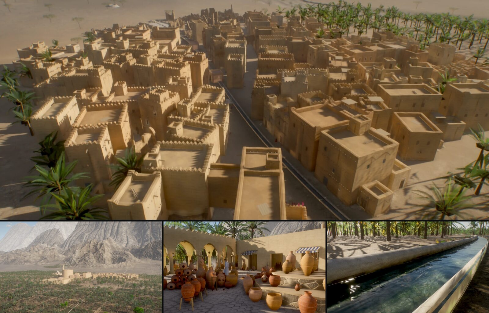

<sub>An oasis town built by 灰叔 Racso with an earlier version of the Mirage approach: every building, palm, wall and water channel is generated in code. The scene itself is not part of this repository; see the [examples](#examples) for what ships here.</sub>

Mirage builds whole places — courtyards, gardens, piers, mountain huts — in three.js **as code**: no Blender, no
model files, no editor. A world is a site plan plus a handful of modules; several agents can build those modules
in parallel, test what they built by walking it with scripted inputs, and ship the result as one HTML file of a
few megabytes that opens from disk.

[English](README.md) · [中文](README.zh-CN.md) · **[Try the examples in your browser](https://mirage-engine-4qj.pages.dev/)**

> **Status: 1.0.0.** The public API is the list in [docs/api.md](docs/api.md): names marked *stable* change only in a
> major release (semver), *experimental* ones may change in a minor release. Not published to npm yet (the package
> names are still to be settled), so use it from a clone. Tested on desktop browsers on Apple silicon; see
> [Status and limits](#status-and-limits).

## Why

- **No asset pipeline.** Geometry, materials, sky, light and sound are generated from code, so an agent that can
  write JavaScript can build the whole place. Photo textures are optional (CC0; two examples use them).
- **Worlds in megabytes.** The examples ship as single files of 0.8–3.0 MB; 2.2 MB of the larger ones is the
  physics engine.
- **Agents build in parallel.** The world protocol gives every module its own file, its own plan fields and its
  own notes section; positions come only from the shared plan, so modules never measure each other.
- **Agents test themselves.** `mirage-playtest` runs a JSON scenario in real Chrome — walk routes, jumps at walls,
  interactions, flicker along a path, frame cost — and writes a pass / fail report and a contact sheet that the
  agent looks at before it hands back.

## Quick start (60 seconds)

Needs Node 22+ and Google Chrome (the tools drive the local Chrome headless).

```sh
git clone https://github.com/paraldaMeta/mirage-engine.git && cd mirage-engine
npm install && npm test                      # engine checks in node, no GPU
cd examples/snow-hut
npx vite build && npx vite preview           # open the printed URL: WASD + mouse, E to use, Esc for the menu
```

Then, from the same folder:

```sh
node ../../packages/tools/src/playtest.mjs scenarios/playtest.json dist   # scripted walk: out/playtest/report.md + sheet.png
node ../../packages/tools/src/package.mjs .                               # release/snow-hut.html, opens from disk
```

## Make your own world (10 minutes, by hand)

The examples are finished places; this is an empty one. A world is a folder in `examples/` with a plan (every
shared position), one file per module, and a scenario that tests it.

```sh
cp -R agent/mirage-brief-to-plan/assets/skeleton examples/my-world && cd examples/my-world
# write plan.js and modules/ground.js, modules/room.js: the three files are in docs/making-a-world.md
npm run dev                                  # http://localhost:5190, rebuilds as you type
npm run build && npm run playtest            # out/playtest/report.md + sheet.png: walk through the door, lean on a wall
npm run package                              # release/my-world.html
```

A module is a function that adds three.js objects to `ctx.root`; what it adds is drawn and collided with:

```js
export default {
  name: 'room',
  build(ctx) {
    const { geom, root, plan } = ctx, b = new geom.MeshBatch();
    b.add(geom.wall({ length: 6.3, height: 2.6, thickness: 0.3, openings: [{ x: 0, width: 1.2, height: 2.1, arch: 'flat' }] }),
      ctx.mat.std({ roughness: 0.92 }), geom.compose([0, 0, plan.room.rect[3]]));
    root.add(b.finish({ name: 'room' }));
  },
};
```

[docs/making-a-world.md](docs/making-a-world.md) has the whole room (built and playtested as written), the four
things newcomers walk into (a door arch taller than its wall, a room with no light of its own, lists under
`plan.points`, what a `perf` step measures) and the escape hatches: plain three materials, your own shaders, glTF
models, `AnimationMixer`, async builds. All guides: [docs/README.md](docs/README.md).

## The AI-native workflow

**brief → plan → parallel modules → playtest → ship.** Each step is a skill in [`agent/`](agent/) (the open Agent
Skills format; install for Claude Code, Codex or Cursor: [agent/INSTALL.md](agent/INSTALL.md)).

| step | skill | output |
|---|---|---|
| a paragraph from the user | `mirage-brief-to-plan` | `BRIEF.md` (idea, mood, scale, target), `plan.js` (every shared position), one brief per module, a scaffold |
| build | `mirage-parallel-build` + `mirage-module` | one worker agent per module, each owning its file, its scenario and its section of `NOTES.md` |
| check | `mirage-playtest` | a report and a contact sheet per module, then for the whole world |
| play | `mirage-game` | interactables, saves, sound and UI from the modules' anchors |
| ship | `mirage-ship` | one HTML file, budgets checked, a static deploy folder; **uploads nothing** |

`examples/agent-trial` was built this way: a lead agent wrote the plan, three fresh sub-agents built the shore,
the pier and the lighthouse in parallel (7–14 minutes each), and every module passed its own playtest before
integration ([TRIAL.md](examples/agent-trial/TRIAL.md)).

## Packages

| package | what it does |
|---|---|
| [`@miragekit/core`](packages/core) | rendering: physical sky and aerial perspective inside every material, sun / moon key light with fitted soft shadows, image-based light captured from the built world, sub-frame accumulation (AA, soft shadows, clean SSAO, depth of field), temporal AA while moving, day / night for any place and time, the `patch()` material-hook system with a GLSL noise library, an optional CC0 texture layer, seeded randomness, geometry helpers, LOD |
| [`@miragekit/world`](packages/world) | the world protocol: site plan validation, modules (`build` / `anchors` / `finalize` / `ambientVolumes`), build order, failure isolation (a throwing module is skipped, the world still loads), per-module randomness, a build report ([docs/world-protocol.md](docs/world-protocol.md)) |
| [`@miragekit/play`](packages/play) | walk, fly, isometric game view, orbit; collision and ground from a walk grid baked from the real geometry; progressive refinement when the view stops; an embed API for host games |
| [`@miragekit/game`](packages/game) | a minimal game layer: Rapier physics (lazy WASM), character controller, doors, an action map (keys, gamepad, touch), procedural Web Audio, entities and interactables, inventory, versioned save / load, an accessible HTML overlay |
| [`@miragekit/net`](packages/net) | multiplayer: an authoritative room, prediction and reconciliation, delta snapshots, WebSocket and WebRTC transports (experimental) |
| [`@miragekit/editor`](packages/editor) | `mirage-editor`: edit a live world in the browser; edits are a layer file over the plan (experimental) |
| [`@miragekit/tools`](packages/tools) | the playtest runner, single-file packager, still snapshots and contact sheets, frame cost, a static deploy folder (no upload) |
| [`@miragekit/assets`](packages/assets) | **BUSL-1.1, not MIT**: the content made in code: surface recipes (35 kinds, weathering decals), the cyber kit (neon street props, cars, civilian robots, the robot parts kit), 125 sounds, the destructibles' material classes |
| [`agent/`](agent) | seven skills for agents, an install guide, a validator (run by `npm test`) |

## Examples

[River Ford](examples/river-ford) crosses a sampled riverbed beneath a flowing water surface. Its source and
test-machine acceptance procedure are on this development branch.

The development branch also includes [Woodland Path](examples/woodland-path), a procedural forest edge for
checking the vegetation kit. It awaits its first test-machine run. The five v0.2.0 examples follow.

| | | |
|---|---|---|
| 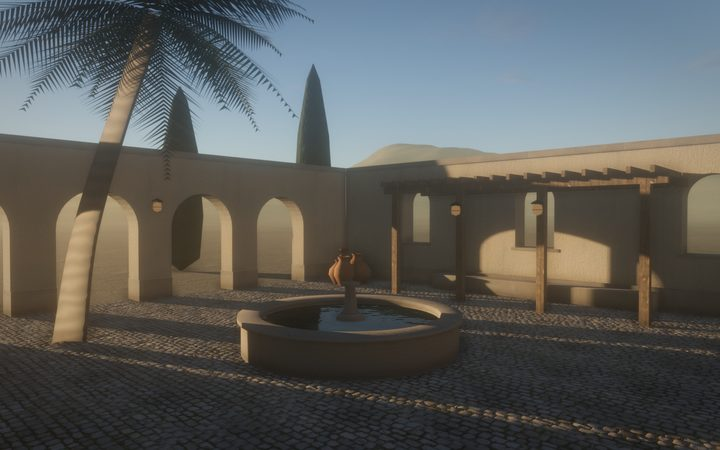 **hello-courtyard** — a walled courtyard with a basin, a pergola and a palm; four modules, five CC0 texture sets, a running clock | 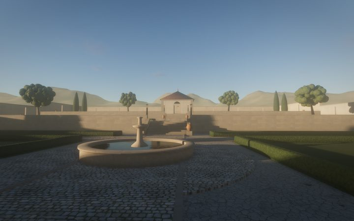 **walled-garden** — three terraces, stairs, pools, a pavilion; six modules (plus one that fails on purpose) | 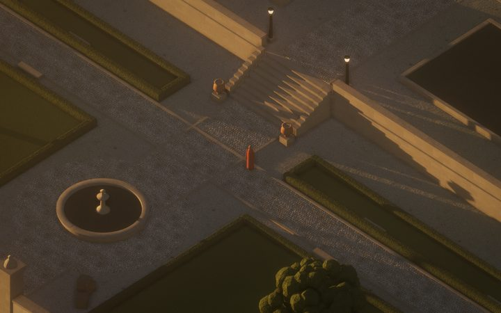 **garden-quest** — the garden as a small game: find the key, open the pavilion, light the lanterns; saves, gamepad, touch |
| 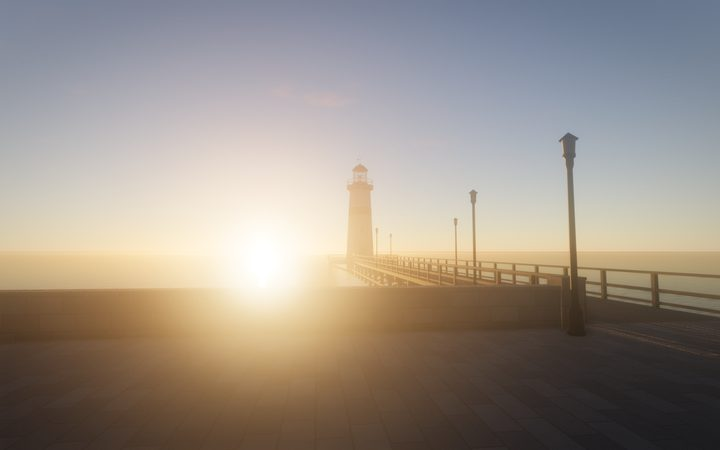 **agent-trial** — a pier and a lighthouse at dusk, built by three agents in parallel from the skill pack | 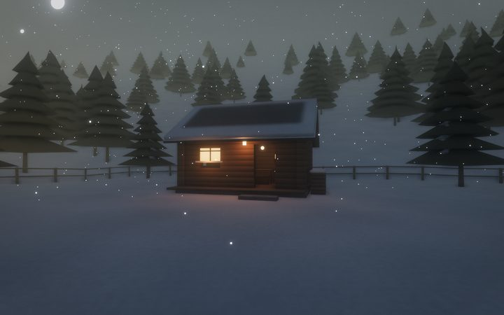 **snow-hut** — a log hut on a snowy slope at blue hour, falling snow; walk in and light the stove | 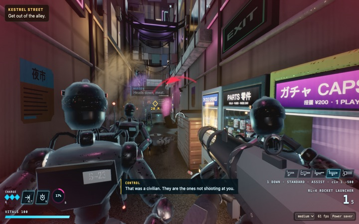 **neon-district** — a cyberpunk first-person shooter in a rain-wet city block at night, **[play it in the browser](https://paraldameta.github.io/mirage-engine/)** (installable, offline, about 2 MB; also [as one HTML file](https://paraldameta.github.io/mirage-engine/neon-district.html) to save and open): clustered neon, reflections, probe GI indoors, volumetric lamps, GPU particles, navgrid enemies with unusual behaviours, melee and sword bosses, destructibles, New Game+; opens in about a second ([what shows what](examples/neon-district/NOTES.md)) |

Each runs with `npx vite build && npx vite preview` in its folder; `npm run playtest` checks it; `npm run package`
makes the single file.

**Demos** (single files, [`examples/demos`](examples/demos)): `day-night` — the snow hut under a running clock
from dawn to night, lamps coming on at dusk (0.80 MB); `assemble` — the walled garden assembling itself module by
module while the loader's report scrolls by, including the module that fails and is skipped (2.11 MB). `materials` — the surface library
([docs/surfaces.md](docs/surfaces.md)): every surface on a sphere, a bevelled cube, a wall and a ground patch under
studio, golden-hour and night light, dry or wet, from 5 m or 0.5 m, baked or procedural. Build them
from the repository root with `node packages/tools/src/package.mjs examples/demos/<name> --out examples/demos/release/<name>.html`.

## Made with the Mirage approach

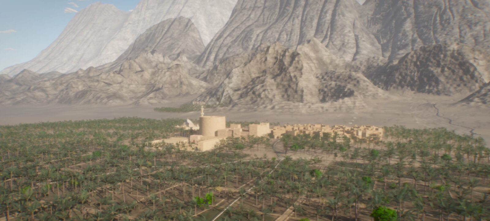

| | |
|---|---|
| 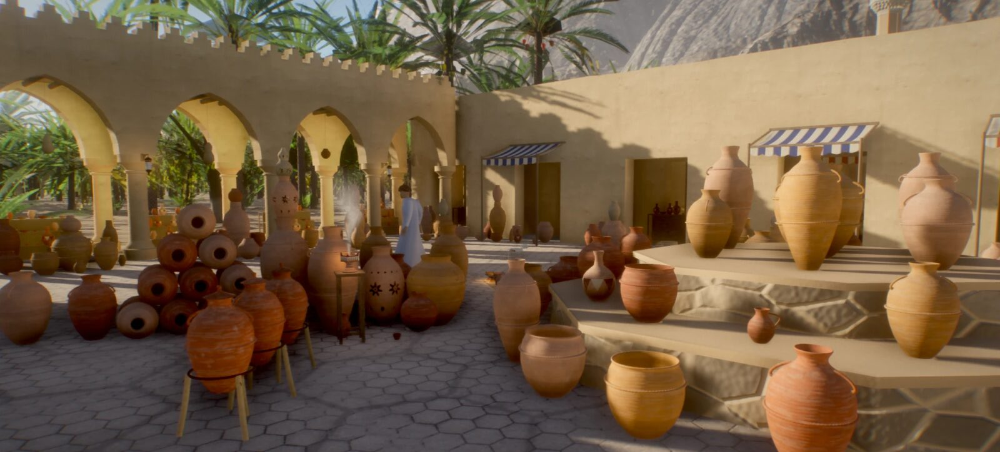 | 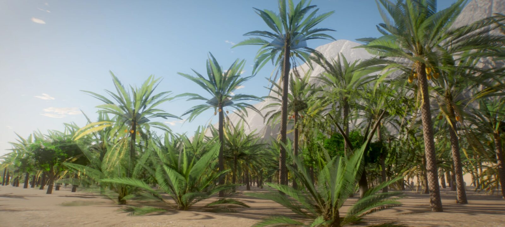 |
| 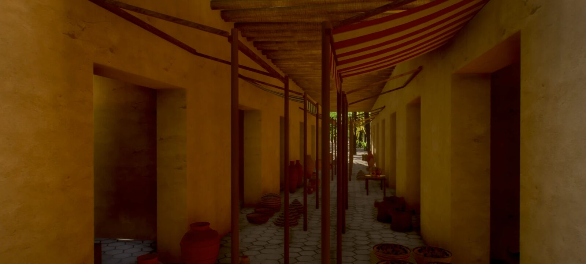 | 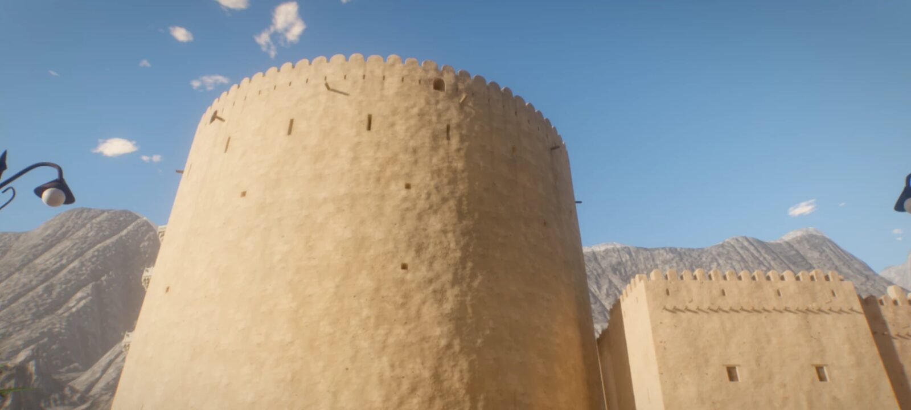 |
| 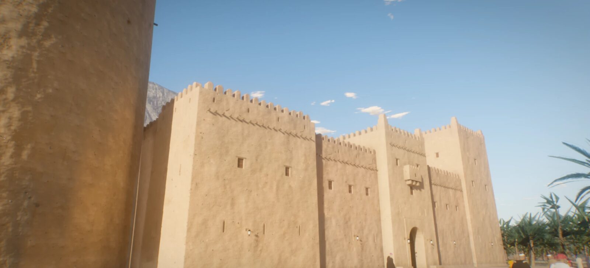 | 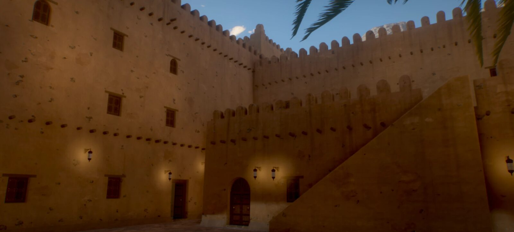 |
| 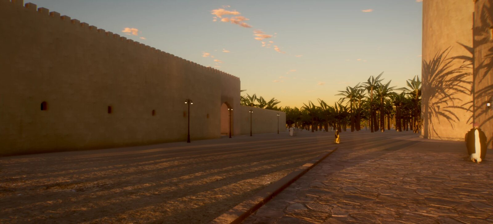 | 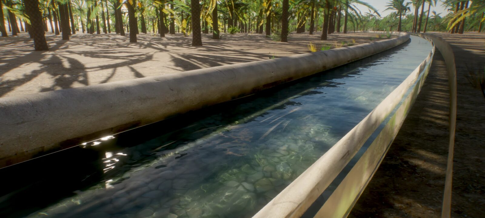 |
| 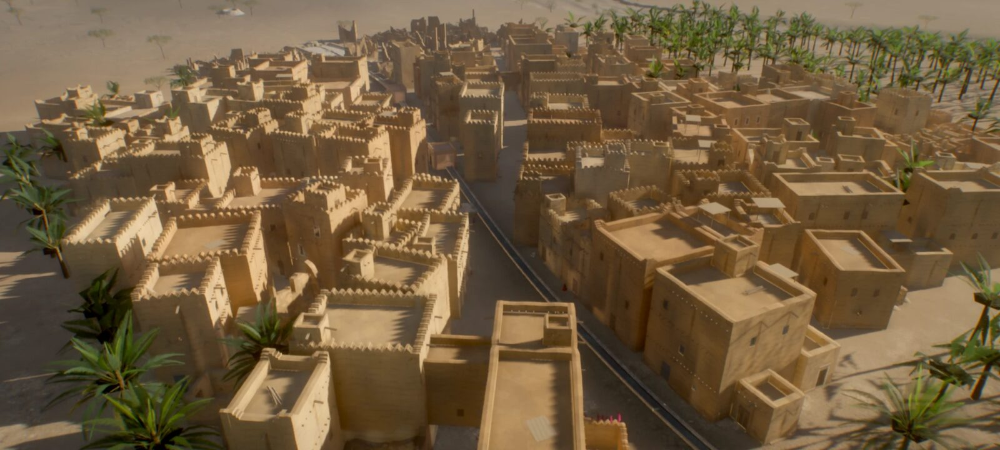 | 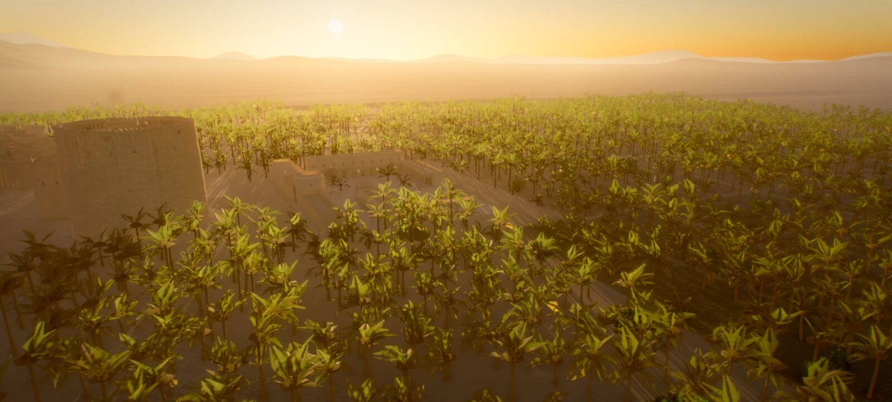 |
| 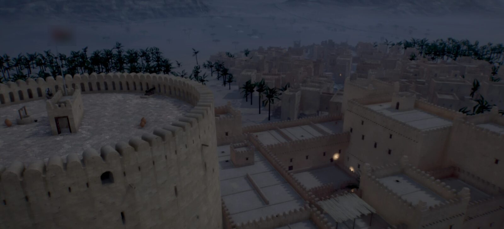 | 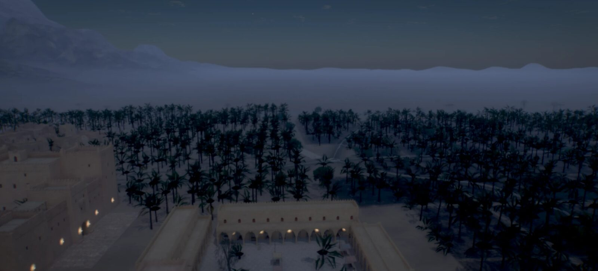 |

*An oasis town built by 灰叔 Racso with an earlier version of this approach (not included in this repository).*
Its code-only version was 1.6 MB; seven agents working in parallel produced the first version in under four
hours. None of its content, code or materials is part of Mirage.

## Status and limits

1.0.0. Honestly:

The 1.0 gates and their evidence: [docs/STATUS-1.0.md](docs/STATUS-1.0.md) and [docs/review-1.0.md](docs/review-1.0.md).

- Tested on an Apple M4 Pro: desktop Chrome (headless and windowed); 0.2.0 also passed in Safari's and Firefox's
  engines through Playwright. Real Safari, phones and integrated GPUs have not been measured; touch is tested in
  Chrome's touch emulation. CI runs the node checks, the package check and every example's build on Ubuntu and macOS.
- Frame cost is 3–6 ms per walking frame on that machine; there is no tuning for weaker GPUs beyond a `low` quality tier.
- The engine favours still frames: the scene clock advances while moving and freezes when stationary so still views
  are bit-identical; moving views use temporal AA, which smears fast-moving things a little.
- Collision comes from a walk grid baked at load (0.125 m cells) and, in games, Rapier trimeshes; very thin or
  sloped geometry needs proxy boxes, and small risers can still catch the character.
- This development branch includes shared vegetation, terrain and water kits and a procedurally rigged traveller in game view. Appearance and performance await test-machine review. [Character review](docs/CHARACTER-REVIEW.md)
- The skill pack was validated by one trial (one lead, three workers, Claude Code). Codex and Cursor setups are
  documented, not run.
- Not on npm yet; worlds live in this repository (`examples/<name>`). TypeScript declarations ship next to the
  sources ([docs/TYPES.md](docs/TYPES.md)). Open issues: [docs/CURSOR-TASKS.md](docs/CURSOR-TASKS.md).

## How Mirage relates to other projects

Mirage is a low-level piece meant to sit **next to** other tools, not replace them.

- **Studio-process skill packs** (teams of role agents for game development) organise *who does what*. Mirage
  gives their world-building and technical-art roles something concrete to build with; [agent/INSTALL.md](agent/INSTALL.md)
  maps roles to Mirage skills.
- **All-in-one apps** that design, generate assets, code, play-test and publish a game are end-to-end products.
  Mirage is a library and a set of conventions you run locally; its output is plain files.
- **Engine-knowledge skill packs** teach agents general game-engine practice. Mirage's skills cover only its own
  protocol and tools and can be used alongside them.
- **Godot, Unity and other engines** are complete, mature engines with editors, asset pipelines and native
  exports. Mirage covers a narrow slice — code-generated web worlds that agents build and test — and does not try
  to match their breadth.

## Licences

Two licences, by directory:

- **MIT** ([LICENSE](LICENSE)): the engine. `packages/core`, `packages/world`, `packages/play`, `packages/game`,
  `packages/net`, `packages/editor`, `packages/tools`, `agent/`, `scripts/`, `docs/` and every example except the
  neon district. Systems, APIs, frameworks and tools: use them for anything the MIT licence allows.
- **Business Source License 1.1** ([packages/assets/LICENSE](packages/assets/LICENSE)): the content.
  `packages/assets` (`@miragekit/assets`: surface recipes, the cyber kit, the sound library, the destructibles'
  material classes) and `examples/neon-district`. Free for non-production use; production use is free for an
  individual using it for themselves, for non-commercial use, and for organisations of up to three people; never to
  offer a competing engine, asset library or content-distribution tool. Each version turns Apache-2.0 four years after
  its first public release. For a commercial licence, open an issue titled "Commercial license" in this repository or
  write to flytoheptameron@outlook.com.

Versions already published on `main` under MIT (the first neon district, its early props, cars, robots and gun
sounds) stay MIT for those versions; the split governs what is published from now on.

## Acknowledgements

Mirage's rendering techniques (physical sky, aerial perspective in materials,
sub-frame accumulation, the material patch system) were learnt from
[Golden Temple](https://github.com/Leonxlnx/golden-temple) by Leon Lin (MIT); no Golden Temple code is included,
and [NOTICE](NOTICE) reproduces its licence as an acknowledgement. Third-party code and assets: [CREDITS.md](CREDITS.md)
(three.js MIT, Rapier Apache-2.0, five CC0 texture sets from Poly Haven).

Credits: Mirage was written by 灰叔 Racso with AI coding agents (Claude Code, Cursor); thanks to Leon Lin for
Golden Temple, to the three.js and Rapier teams, and to Poly Haven's CC0 artists.

Contributing: [CONTRIBUTING.md](CONTRIBUTING.md) · Changes: [CHANGELOG.md](CHANGELOG.md)
