# Mirage

**给 AI Agent 用的纯代码世界引擎。**

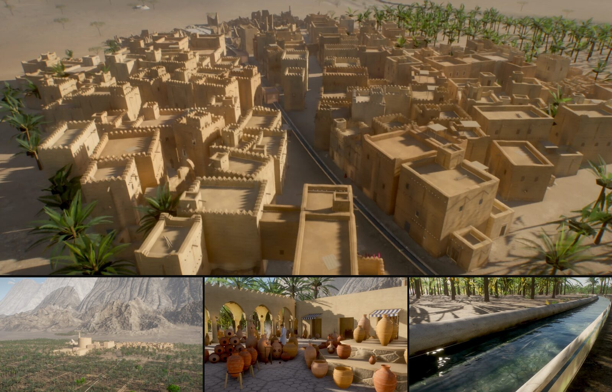

<sub>灰叔 Racso 用 Mirage 方法的早期版本做的一座绿洲古城：每一栋房子、每一棵椰枣树、每一段城墙和水渠都由代码生成。这个场景本身不在本仓库中，仓库里自带的见下方示例。</sub>

Mirage 用 three.js 把整个地方——院子、园林、码头、山间小屋——**写成代码**：不开 Blender、不用模型文件、没有编辑器。
一个世界 = 一张总平面图 + 几个模块；多个 Agent 可以并行各建一个模块，用脚本化的输入把自己建的东西走一遍来自测，
最后打包成一个几 MB、从磁盘直接打开的 HTML 文件。

[English](README.md) · [中文](README.zh-CN.md)

> **状态：pre-alpha（0.2.0）。** 下面五个示例在作者（灰叔 Racso）的机器上能跑通。接口还会变，没有发到 npm，只在 Apple 芯片的桌面
> Chrome 上测过。见[现状与局限](#现状与局限)。

## 为什么

- **没有资产管线。** 几何、材质、天空、光照、声音都由代码生成，会写 JavaScript 的 Agent 就能把整个地方建出来。照片贴图可选（只收 CC0）。
- **世界以 MB 计。** 示例的单文件 0.8–3.0 MB；大的那几个里有 2.2 MB 是物理引擎。
- **Agent 并行建造。** 世界协议给每个模块独立的文件、独立的总平面图字段和独立的笔记段落；位置只从总平面图取，模块之间从不互相量尺寸。
- **Agent 自己测。** `mirage-playtest` 在真 Chrome 里跑一个 JSON 场景脚本——走路线、往墙上跳、交互、沿路径测闪烁、测帧时间——输出通过 / 不通过报告和联系表，Agent 交回前要看过。

## 60 秒上手

需要 Node 22+ 和 Google Chrome（工具会无头驱动本机 Chrome）。

```sh
git clone https://github.com/paraldaMeta/mirage-engine.git && cd mirage-engine
npm install && npm test                      # 引擎自检，在 node 里跑，不需要 GPU
cd examples/snow-hut
npx vite build && npx vite preview           # 打开打印出的网址：WASD + 鼠标，E 交互，Esc 菜单
```

在同一个目录里接着：

```sh
node ../../packages/tools/src/playtest.mjs scenarios/playtest.json dist   # 脚本化走一遍：out/playtest/report.md + sheet.png
node ../../packages/tools/src/package.mjs .                               # release/snow-hut.html，可从磁盘打开
```

## AI 原生的工作流

**简报 → 总平面图 → 并行模块 → 自测 → 交付。** 每一步是 [`agent/`](agent/) 里的一个技能（开放的 Agent Skills
格式；Claude Code、Codex、Cursor 的安装方法见 [agent/INSTALL.md](agent/INSTALL.md)）。

| 步骤 | 技能 | 产出 |
|---|---|---|
| 用户的一段话 | `mirage-brief-to-plan` | `BRIEF.md`（想法、氛围、尺度、目标）、`plan.js`（所有共用位置）、每个模块的简报、项目骨架 |
| 建造 | `mirage-parallel-build` + `mirage-module` | 每个模块一个工作 Agent，各自拥有自己的文件、场景脚本和 `NOTES.md` 里的一节 |
| 检查 | `mirage-playtest` | 每个模块、再到整个世界的报告和联系表 |
| 能玩 | `mirage-game` | 由模块挂点生成的交互物、存档、声音和界面 |
| 交付 | `mirage-ship` | 单个 HTML 文件、预算检查、静态部署目录；**什么都不上传** |

`examples/agent-trial` 就是这样做出来的：一个主 Agent 写总平面图，三个全新的子 Agent 并行建海岸、栈桥和灯塔
（各 7–14 分钟），每个模块在合并前都通过了自己的自测（[TRIAL.md](examples/agent-trial/TRIAL.md)）。

## 各个包

| 包 | 做什么 |
|---|---|
| [`@mirage/core`](packages/core) | 渲染：物理天空和写进每个材质的空气透视、太阳 / 月亮主光与拟合的软阴影、从建好的世界捕获的环境光、子帧累积（抗锯齿、软阴影、干净的 SSAO、景深）、移动时的时间抗锯齿、任意地点和时刻的昼夜、带 GLSL 噪声库的 `patch()` 材质注入、可选的 CC0 贴图层、固定种子随机数、几何工具、LOD |
| [`@mirage/world`](packages/world) | 世界协议：总平面图校验、模块（`build` / `anchors` / `finalize` / `ambientVolumes`）、建造顺序、容错（报错的模块被跳过，世界照常加载）、每模块独立随机流、建造报告（[docs/world-protocol.md](docs/world-protocol.md)） |
| [`@mirage/play`](packages/play) | 走、飞、等距游戏视角、环绕；由真实几何烘焙走动网格得到碰撞和地面；镜头停下后逐步精细化；嵌入宿主游戏的 API |
| [`@mirage/game`](packages/game) | 最小游戏层：Rapier 物理（WASM 懒加载）、角色控制器、门、动作映射（键鼠、手柄、触屏）、程序化 Web Audio、实体与交互物、背包、带版本的存档读档、无障碍 HTML 界面层 |
| [`@mirage/tools`](packages/tools) | 自测运行器、单文件打包、静帧快照和联系表、帧时间、静态部署目录（不上传） |
| [`agent/`](agent) | 七个给 Agent 的技能、安装说明、校验器（`npm test` 会跑） |

## 示例

| | | |
|---|---|---|
| 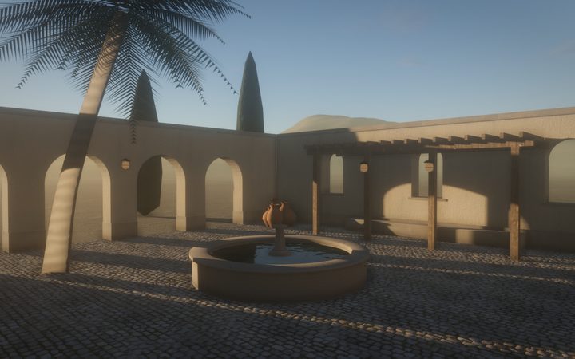 **hello-courtyard**：带水池、花架和棕榈的围合院子；四个模块、五套 CC0 贴图、运行时钟 | 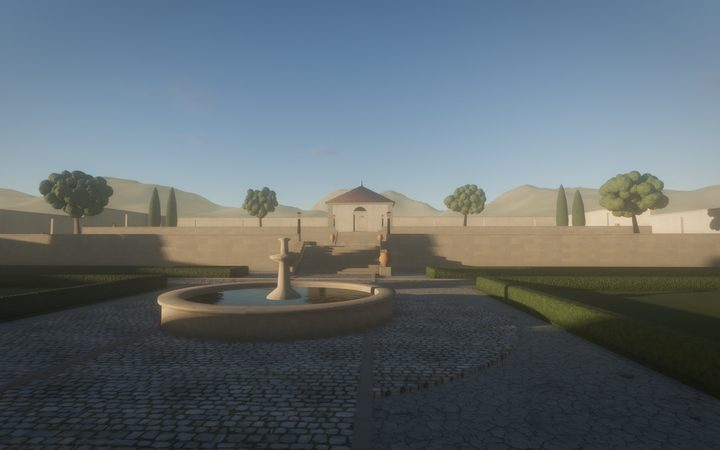 **walled-garden**：三层台地、台阶、水池、亭子；六个模块（外加一个故意报错的） | 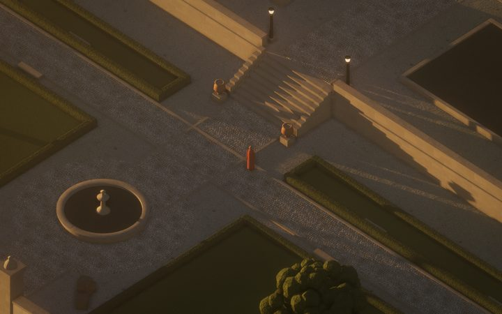 **garden-quest**：把园林做成小游戏：找钥匙、开亭子、点灯笼；存档、手柄、触屏 |
| 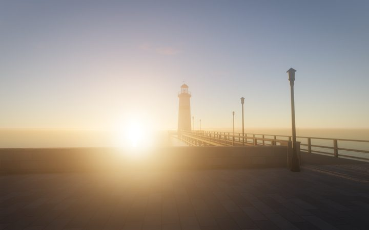 **agent-trial**：黄昏的栈桥和灯塔，三个 Agent 按技能包并行建成 | 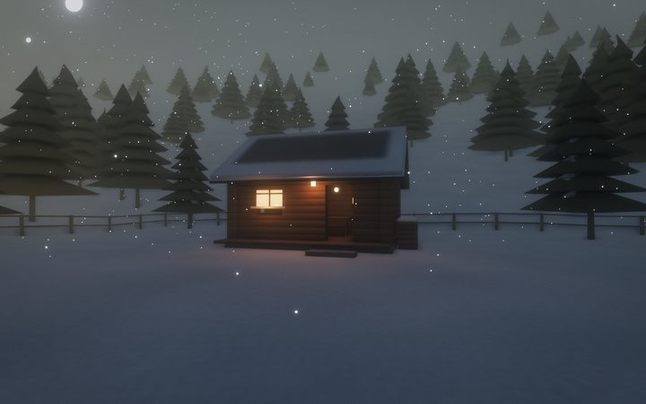 **snow-hut**：蓝调时刻雪坡上的木屋，下着雪；走进去把炉子生起来 | |

每个示例在自己目录里 `npx vite build && npx vite preview` 就能跑；`npm run playtest` 自测；`npm run package` 打成单文件。

**小演示**（单文件，[`examples/demos`](examples/demos)）：`day-night`——雪屋在运行时钟下从清晨到夜里，黄昏时灯亮起（0.80 MB）；
`assemble`——园林一个模块一个模块地“自己长出来”，旁边滚动加载器自己的报告，包括那个报错后被跳过的模块（2.11 MB）。
在仓库根目录用 `node packages/tools/src/package.mjs examples/demos/<名字> --out examples/demos/release/<名字>.html` 打包。

## 用 Mirage 的方法做的作品

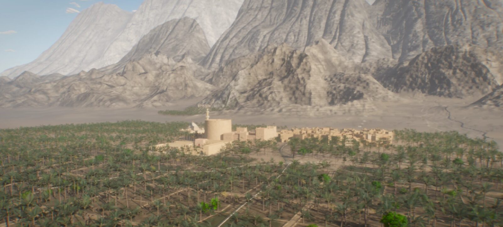

| | |
|---|---|
| 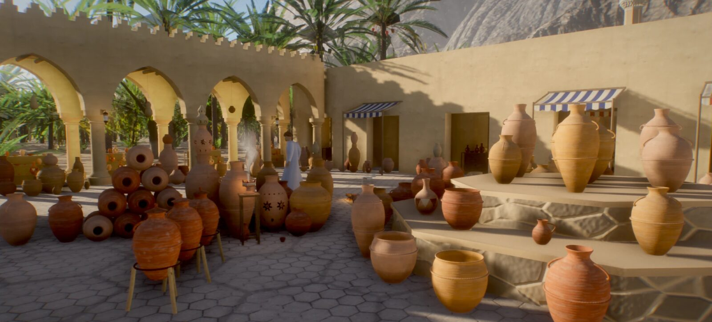 | 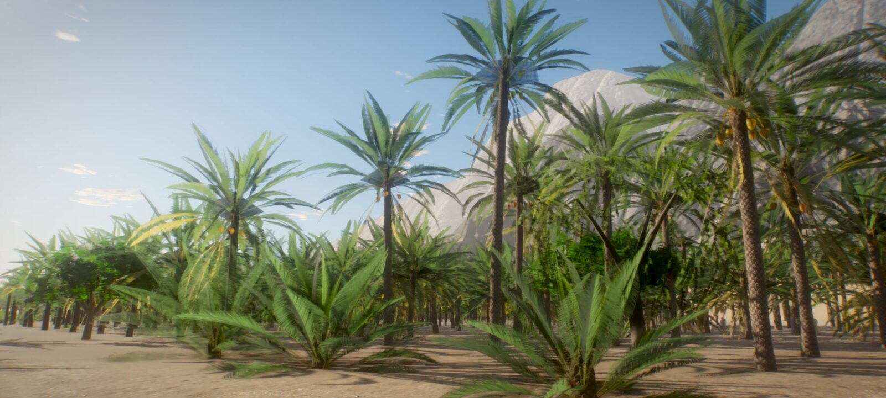 |
| 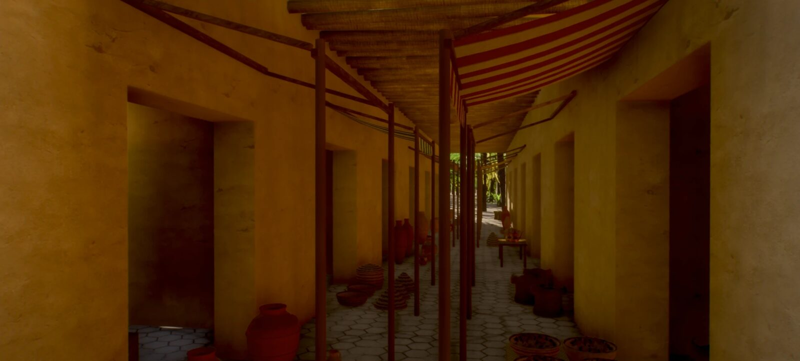 | 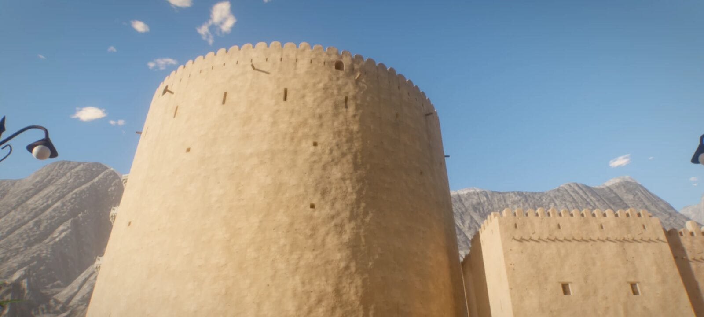 |
| 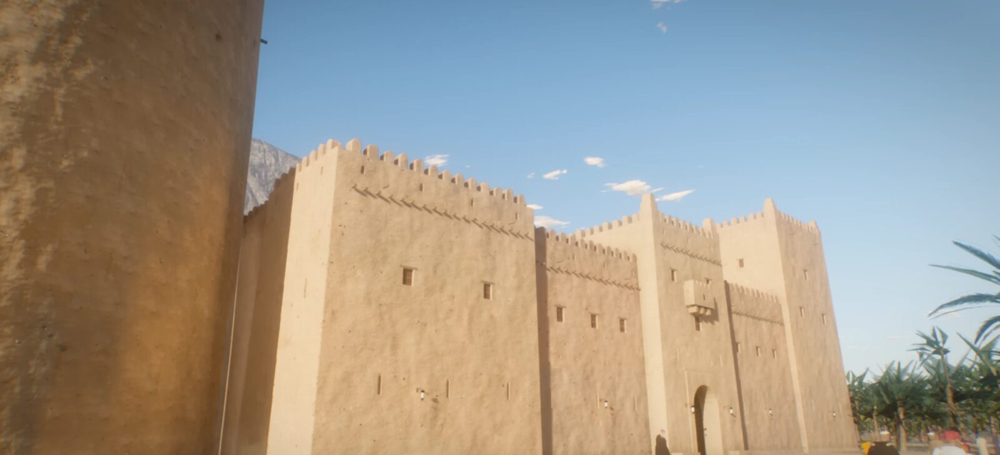 | 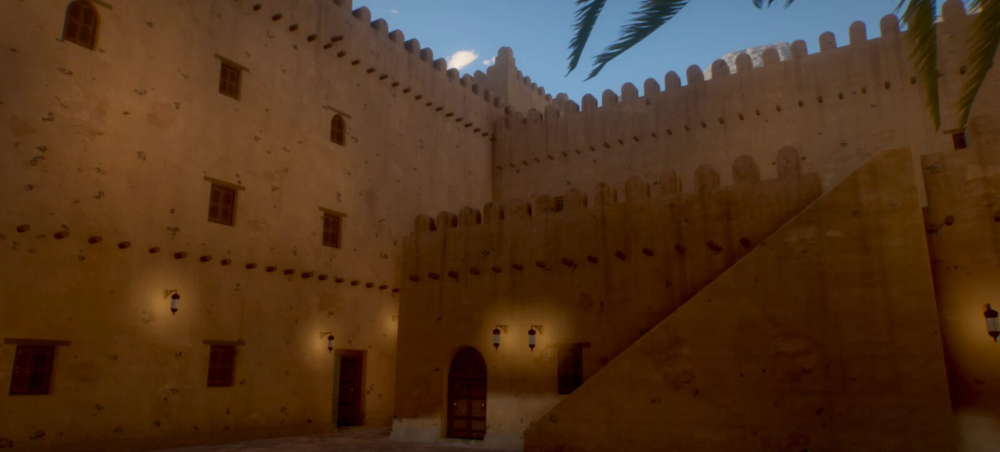 |
| 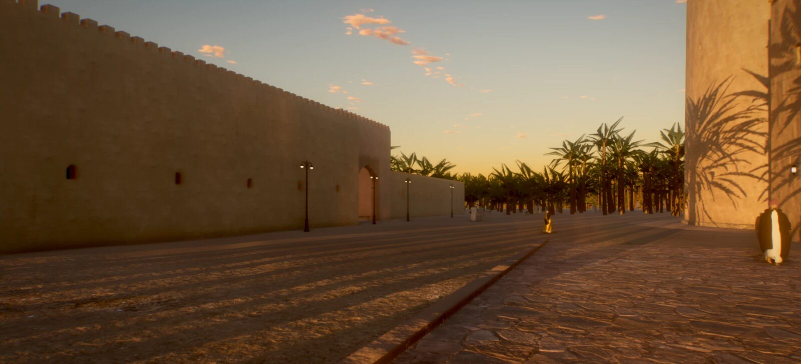 | 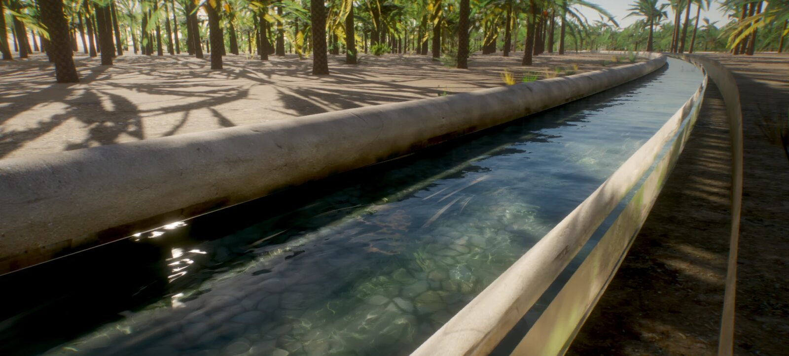 |
| 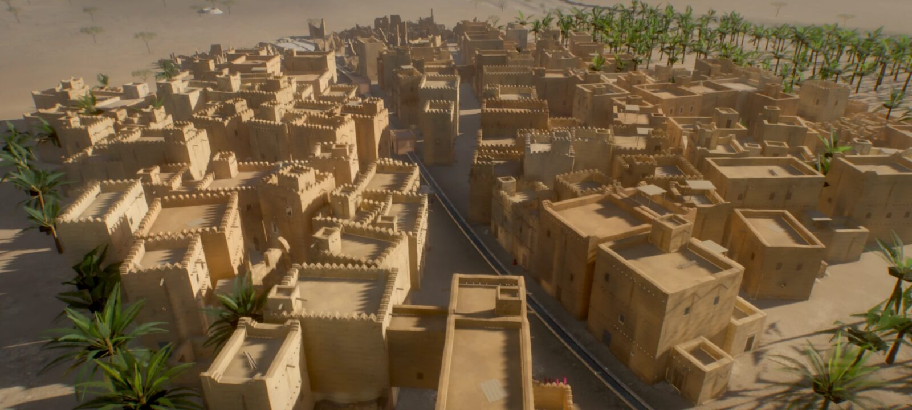 | 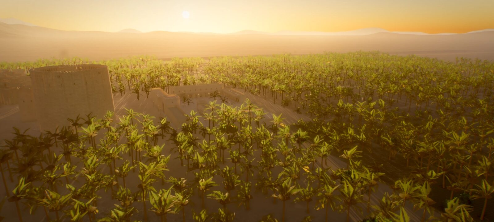 |
| 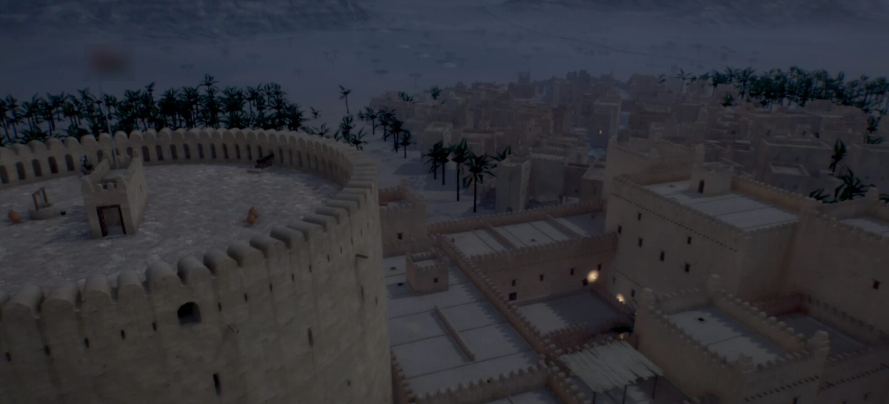 | 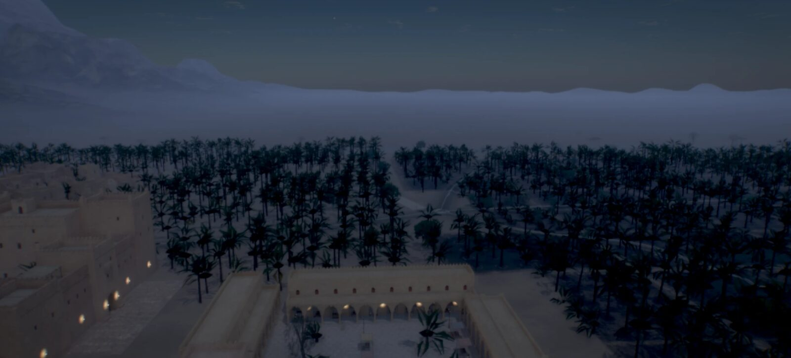 |

*灰叔 Racso 用这套方法的早期版本做的一座绿洲小城（不包含在本仓库中）。* 纯代码版 1.6 MB；七个 Agent 并行，不到四小时出了第一版。
它的内容、代码和材质都不属于 Mirage。

## 现状与局限

pre-alpha，如实说：

- 只在 Apple M4 Pro 的桌面 Chrome（无头和有窗口）上测过；Safari、Firefox、手机都没测。
- 这台机器上走动每帧 3–6 ms；除了 `low` 画质档，没有为弱 GPU 调过。
- 引擎偏向静帧：走动时时钟和风是冻结的，保证静止画面逐像素一致；移动画面用时间抗锯齿，快速运动的东西会有一点拖影。
- 碰撞来自加载时烘焙的走动网格（0.125 m 格）和游戏里的 Rapier 三角网格；很细或倾斜的几何要加代理盒，小台阶仍可能卡住角色。
- 植被、地形、水面每个世界自己写（还没有共用工具包）；人物是占位。
- 技能包只验证过一轮（一个主 Agent、三个工作 Agent，Claude Code）。Codex 和 Cursor 的用法只写了文档，没实际跑过。
- 没发 npm；包名和接口会变。已知问题：[docs/CURSOR-TASKS.md](docs/CURSOR-TASKS.md)。

## 和其他项目的关系

Mirage 是底层的一块，设计上是**和别的工具并用**，不是替代它们。

- **工作室流程类技能包**（游戏开发的角色 Agent 团队）管“谁做什么”。Mirage 给它们的世界建造、技术美术角色一个具体能用的东西；[agent/INSTALL.md](agent/INSTALL.md) 里有角色到技能的对照。
- **一体化应用**（设计、生成素材、写代码、试玩、发布全包）是端到端的产品。Mirage 是在本地跑的库和约定，产物是普通文件。
- **引擎知识类技能包**教 Agent 通用的游戏引擎做法。Mirage 的技能只讲它自己的协议和工具，可以和它们一起用。
- **Godot、Unity 等引擎**是完整、成熟的引擎，有编辑器、资产管线和原生导出。Mirage 只覆盖很窄的一块——由 Agent 建造和自测的、代码生成的网页世界——不打算追求它们的广度。

## 许可与致谢

MIT，见 [LICENSE](LICENSE)。Mirage 的渲染技术思路（物理天空、材质里的空气透视、子帧累积、材质注入系统）学自 Leon Lin 的
[Golden Temple](https://github.com/Leonxlnx/golden-temple)（MIT）；仓库里没有 Golden Temple 的代码，[NOTICE](NOTICE)
里保留它的许可原文以示致谢。第三方代码和素材见 [CREDITS.md](CREDITS.md)（three.js MIT、Rapier Apache-2.0、Poly Haven 的五套 CC0 贴图）。

致谢：Mirage 由灰叔 Racso 与 AI 编程 Agent（Claude Code、Cursor）一起写成；感谢 Leon Lin 的 Golden Temple、three.js 和 Rapier 团队、Poly Haven 的 CC0 作者们。

参与贡献：[CONTRIBUTING.md](CONTRIBUTING.md) · 变更记录：[CHANGELOG.md](CHANGELOG.md)
