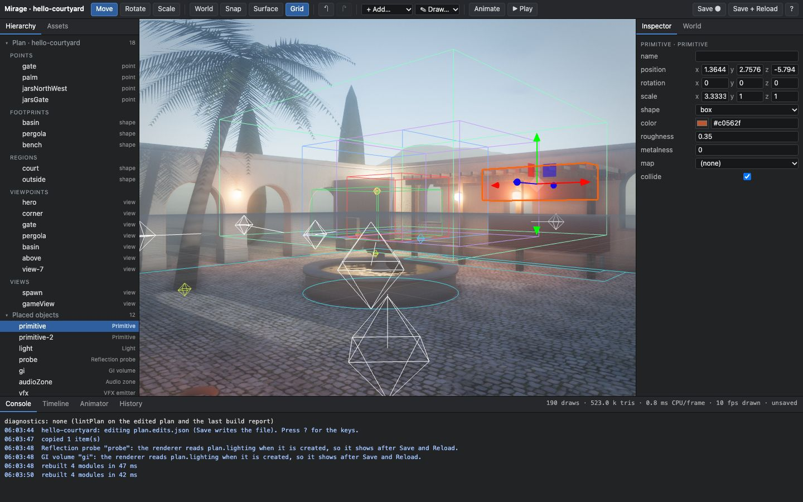
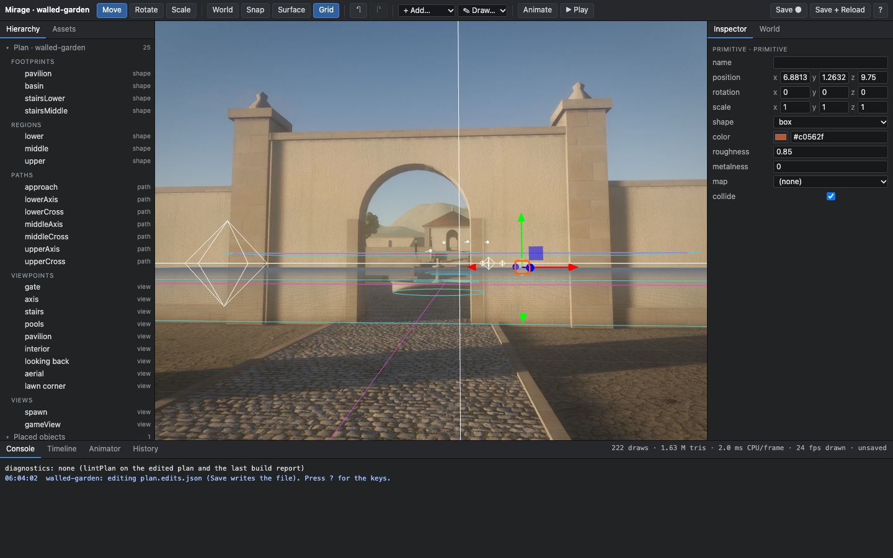
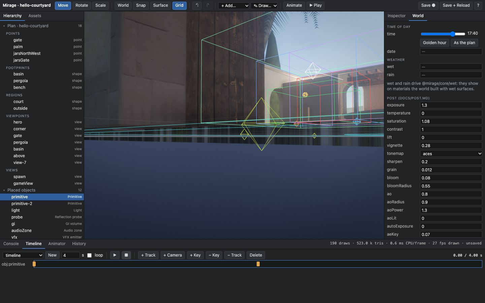
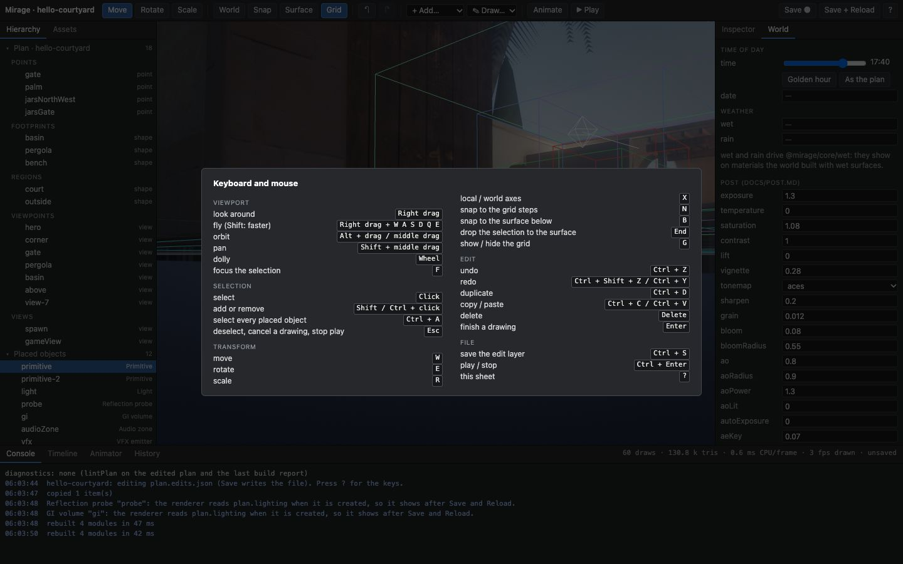

# The editor

`@mirage/editor` is a visual editor that runs in the browser against a live Mirage world. Experimental and opt-in:
a project that does not import it is unchanged, and a project that does, with an empty edit layer, renders the same
pixels as before (measured below).

```sh
npx mirage-editor examples/hello-courtyard            # read-only towards the disk: Save keeps the layer in memory
npx mirage-editor examples/hello-courtyard --write    # Save writes examples/hello-courtyard/plan.edits.json
npx mirage-editor examples/walled-garden --write --port 0 --open
```



The page is the project's own page, served through Vite exactly as `vite dev` would, with the editor's client
added: the world you edit is the world the project builds, with its modules, textures and lighting.

## What it does

**Viewport.** Fly (right drag + W A S D Q E) and orbit (Alt + drag) camera. Click selects, with an outline;
Shift/Ctrl + click adds or removes; Ctrl + A takes every placed object. Move / rotate / scale gizmos in local or
world axes, with snapping to grid steps (N) and to the surface under the object (B, or End to drop once). Focus
(F), duplicate, copy / paste, delete. Every edit, whatever made it, is one entry of a command stack: Ctrl + Z and
Ctrl + Shift + Z undo and redo all of them, and the History tab lists them.



**Panels.** Hierarchy (the plan's points, footprints, regions, paths and viewpoints, the placed objects, and the
scene nodes the modules built). Inspector with typed fields: numbers that drag, vectors, colours, enums, asset
pickers; the plan's fields are typed from `@mirage/world`'s `plan.schema.json`, a world's own fields from their
values. Asset browser: the project's glTF models and textures, the effects of `VFX_LIBRARY`, audio files. Console:
the editor's log and the diagnostics (`MG` codes of `docs/diagnostics.md`, from `lintPlan` on the edited plan and
the last build report). Stats: draw calls, triangles, CPU ms per frame.

**Placing things, as plan data.** `+ Add…` or a click in the asset browser places one of twelve object types:

| type | what it becomes |
|---|---|
| `model` | a glTF through `@mirage/core/assets` |
| `primitive`, `wall` | a box / sphere / cylinder / plane, or a wall along drawn points, with colour, roughness, metalness, a texture |
| `light` | a point or spot light (`world.lighting.addLight` on a clustered world, a three light otherwise) |
| `probe`, `gi` | `plan.lighting.probes` / `plan.lighting.gi` for `createWorldRenderer({ lighting })` |
| `audioZone`, `sound` | `plan.audio.zones` / `plan.audio.emitters` for the audio engine |
| `vfx` | an emitter of a `VFX_LIBRARY` effect |
| `nav` | `plan.nav.areas` (walk / slow / blocked, a cost) |
| `trigger` | `plan.triggers` (a box, an event name, once) |
| `spawnPoint` | `plan.spawns` (position, yaw, team) |

Viewpoints are plan entries (`viewpoints[i]`): select one, move its eye, "Look through".

**Round trip.** Save (Ctrl + S) writes the edit layer; "Save + Reload" loads the page again from it. The layer is
plain JSON with sorted keys:

```json
{ "version": 1,
  "set": { "points.palm": [3, 0, 4] },
  "objects": { "light": { "type": "light", "position": [0, 3, 0], "intensity": 30, "...": "..." } },
  "nodes": { "walls/3": { "material": { "roughness": 0.35 } } },
  "env": { "time": 17.5, "post.exposure": 1.3 },
  "timelines": { "timeline": { "duration": 4, "tracks": [] } } }
```

The plan file itself is JavaScript with constants and comments, so the editor never rewrites it.

**Play in editor.** Ctrl + Enter starts the project's own `createPlay` in walk mode at the spawn, with the placed
trigger volumes reporting to the console; Ctrl + Enter or Esc stops it and puts the camera, the selection and the
document back. Time of day is a slider, wet and rain are fields, and every `world.post` setting and `light2`
toggle is a live field in the World tab; they are edits like the others (undo, save).



**Tools.** Draw: walls (a placed `wall`), paths and regions (plan entries), click by click. Material and parameter
editor: select any node a module built and edit its material's values (a `nodes` override). Timeline: tracks of
transform keys for placed objects and nodes, camera keys, scrubbing and playback on `createTimeline` of
`@mirage/play`. Animator viewer: the states, weights and parameters of the animators the page hands over with
`attach({ animators })`; it shows state, it does not edit graphs.

**Keys.** `?` shows the sheet.

| | |
|---|---|
| Right drag, + W A S D Q E | look, fly (Shift: faster) |
| Alt + drag / middle drag, Shift + middle drag, wheel | orbit, pan, dolly |
| F | focus the selection |
| Click, Shift / Ctrl + click, Ctrl + A, Esc | select, add or remove, all placed objects, deselect |
| W, E, R | move, rotate, scale |
| X, N, B, End, G | local / world axes, grid snap, surface snap, drop to the surface, grid |
| Ctrl + Z, Ctrl + Shift + Z or Ctrl + Y | undo, redo |
| Ctrl + D, Ctrl + C / Ctrl + V, Delete | duplicate, copy / paste, delete |
| Enter, Esc | finish, cancel a drawing |
| Ctrl + S, Ctrl + Enter | save the layer, play / stop |



The screenshots on this page are written by the check (`node packages/editor/editor-check.mjs --shots`).

## Wiring a project

```js
import { editable } from '@mirage/editor/runtime';
import edits from './plan.edits.json';                       // {} until the first save

const ed = editable(plan, edits);
const world = createWorldRenderer({ ..., lighting: ed.lighting(lighting) });
const buildOpts = (p) => ({ plan: p, modules, shared });
const built = await buildWorld(world, buildOpts(ed.plan));
await ed.apply(world, built);                                 // placed objects, node overrides, environment, timelines
const play = createPlay(world, playOpts);
ed.attach({ world, built, play, rebuild: buildOpts, makePlay: (o) => createPlay(world, { ...playOpts, mode: 'walk', ...o }) });
```

`rebuild` lets the editor run the modules again in place after a plan edit (moving a point, redrawing a region);
without it such edits show after Save + Reload. `makePlay` is play-in-editor. `examples/hello-courtyard/main.js`
and `examples/walled-garden/main.js` are wired this way. A page that is not wired still opens: the editor then
works on placed objects and node overrides only and says so.

URL flags of the served page: `?editor=0` is the project without the editor (what a visitor gets; the saved layer
still applies through the import). The project's own flags keep working.

The data side has no DOM and no three.js and runs in Node: `applyEdits(plan, layer)`, `planHash(plan)`,
`createDocument(plan, layer)` (the command stack), `OBJECT_TYPES`, `fieldsFromSchema`. `docs/api.md` has the rows.

## The server

It can write a file, so it is narrow on purpose (`packages/editor/src/server.mjs`, checked by
`packages/editor/check.mjs`):

- it listens on 127.0.0.1 and there is no option to change that;
- every request must have a Host that is this server on a loopback name (a DNS-rebinding page has another) and,
  when the browser sends one, an Origin that is this server: otherwise 403;
- POSTs need the per-run token the served page holds and an `application/json` body under 4 MB;
- the one file it writes is fixed when it starts (`plan.edits.json`, or `--layer name.json`), must lie inside the
  project directory after links are resolved, and is written only with `--write`. No request names a path;
- files are served by Vite under `fs.strict`, after a check that the path with links resolved is still inside the
  workspace; the asset listing follows no links and skips dot folders, `node_modules` and build output;
- no hot-reload socket: one port, plain HTTP.

It is a development tool for your own machine. Do not put it behind a proxy to share it.

## Measured

`node packages/editor/editor-check.mjs` drives the editor in headless Chrome on both wired examples (1440 x 900,
Apple M-series GPU, WebGL2): click-select, a gizmo drag, undo by key, snap, scale, rotate, duplicate, copy/paste,
multi-move, delete, one of every object type, a plan point moved and rebuilt, an inspector field, time and
exposure, a timeline with two keys, play and stop, undo of everything, redo of everything, save, reload, and the
page without the editor. It compares plan hashes and stills (SSIM over the viewport).

| | hello-courtyard | walled-garden |
|---|---|---|
| editor open, warm Vite cache | 726 to 1,698 ms (three runs) | 953 to 1,004 ms |
| in-place rebuild after a plan point moves (incl. settle) | 620 ms | 646 ms |
| undo steps in the session | 28 | 28 |
| still after undoing everything vs before any edit (SSIM) | 0.9961 to 0.9997 (three runs) | 0.9998 |
| saved layer | 5,360 bytes | 5,393 bytes |
| plan hash after save and reload | equal | equal |
| still after reload vs before it (SSIM) | 0.9844 | 0.9997 |
| `?editor=0` page vs the reloaded editor, same viewpoint (SSIM) | 1 (0 differing pixels) | 1 (0 differing pixels) |

The reload still is below 1 on hello-courtyard because a reflection probe and a GI volume placed in a session take
effect when the renderer is created, so they first show after the reload; the check allows 0.97 there.

Opt-in: with `plan.edits.json` = `{}`, `mirage-snap` stills of the built examples at the base commit and with the
editor wired in are byte-identical (hello-courtyard 6 views, walled-garden 9 views, 960 x 600, grain 0). The first
load grows by 16.8 kB (hello-courtyard) and 25.1 kB (walled-garden) of JavaScript before compression; the glTF
loaders, effects and the timeline are separate chunks fetched only when a layer uses them.

Frame cost of the editor's own overlay (helpers, outline, gizmo): not measured. The editor draws on demand and is
idle when nothing changes.

## Limits

- Probe and GI volumes placed in a session show after Save + Reload (the renderer reads `lighting` once).
- After an in-place rebuild the first build's `onUpdate` callbacks keep running until the next reload.
- Stopping a timeline puts placed objects and overridden nodes back; a node a timeline moved that has no override
  stays where the timeline left it until the next reload.
- No terrain or height drawing: the plan model has no heightfield to write to. Ground is what modules build.
- Node overrides address nodes by their path in the scene; a module that changes its own structure can orphan one
  (the console lists overrides that found no node).
- Model placement reads glTF; there is no importer UI, texture compression or LOD setup in the editor.
- One document, one user, one undo stack per session; history does not survive a reload.

## What Unity and Unreal editors have that this does not

Plainly: this is a scene and parameter editor over a code-first engine, not a replacement for those editors.

- **Prefabs / Blueprints.** No reusable, nested, overridable object templates. A placed model is one object;
  reuse is a module in code.
- **Visual scripting.** None. Triggers emit named events; behaviour is JavaScript.
- **Material graph.** None. The material editor changes values (colour, roughness, metalness, maps' parameters)
  of materials that code built; it cannot author a shader.
- **Profiler.** The stats line only. No CPU/GPU timeline, no memory view, no frame debugger. `mirage-perf` and
  `mirage-gpu-load` are command-line tools.
- **Build pipeline UI.** None. Building, packaging and deploying stay `vite build`, `mirage-package`,
  `mirage-deploy`.
- **Collaboration.** None: no multi-user editing, locking or merge tooling beyond the layer being a small sorted
  JSON file that diffs well.
- **Plugin ecosystem.** No extension API, no marketplace. The client is not an API.
- Also missing: terrain and foliage painting, an animation graph editor (the viewer is read-only), a curve editor
  for timeline keys (keys are linear or eased, set by fields), lightmap baking UI, a nav-mesh visualiser beyond the
  area boxes, asset import settings, and docking or saved layouts.
