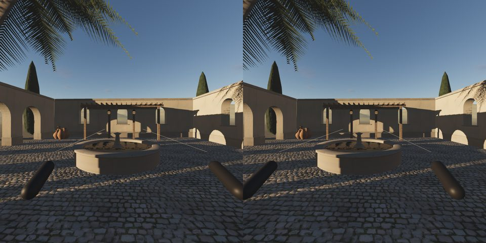
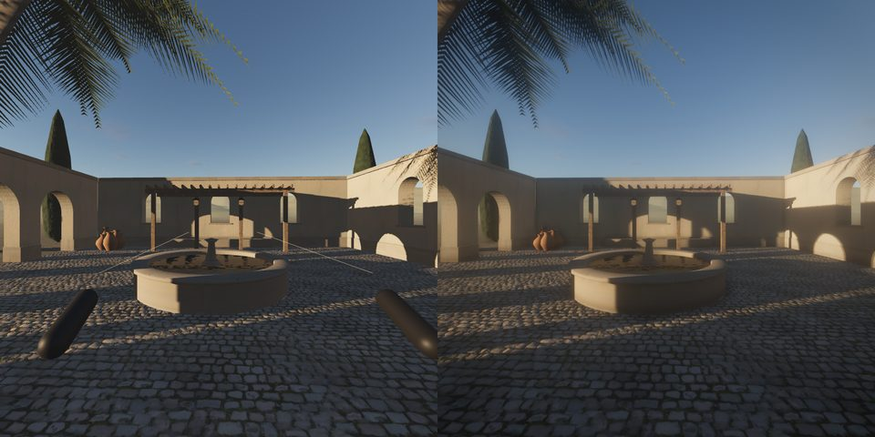
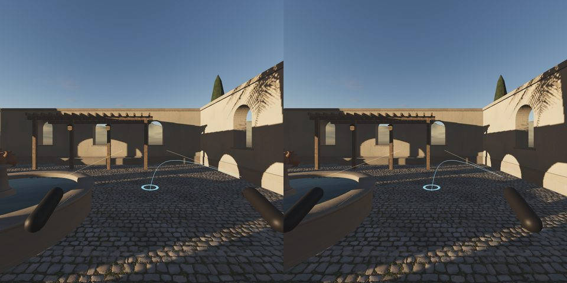
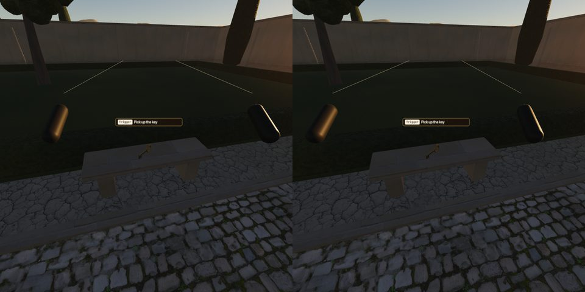
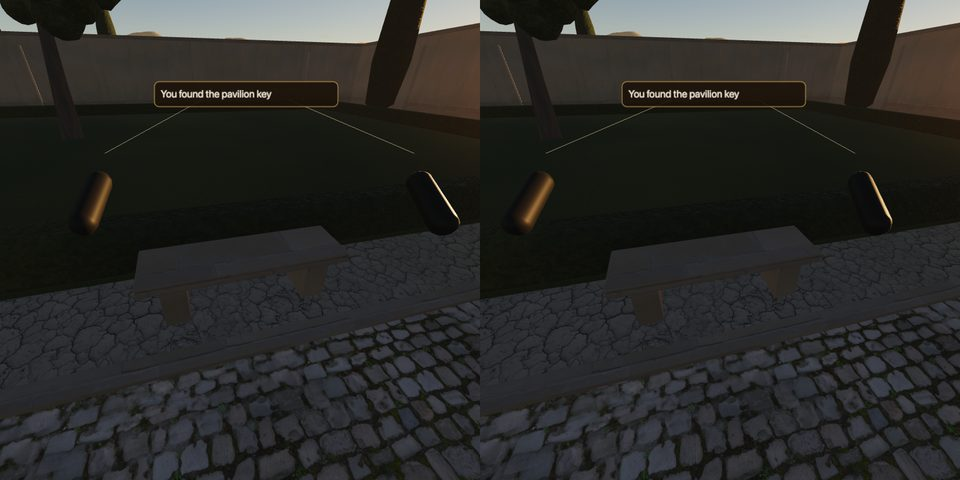
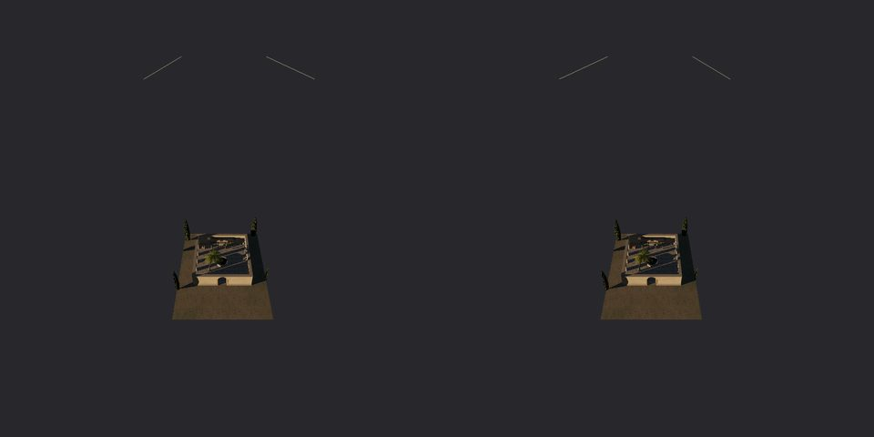

# WebXR: a mirage world in a headset

`createXR(play)` (in `@mirage/play`, experimental) lets any world be entered in a VR headset (`immersive-vr`) or set
on a floor or table as a model (`immersive-ar`). All seven examples opt in: open one in a headset browser (Meta
Quest Browser, Android Chrome with a headset, Pico, Wolvic) and press **Enter VR** or **Enter AR**.

```js
import { createWorldRenderer } from '@mirage/core';
import { createPlay, createXR, xrSupport } from '@mirage/play';

const xrs = await xrSupport();                                   // { vr, ar }: ask before creating the world
const world = createWorldRenderer({ ..., xr: xrs.vr || xrs.ar }); // a multisampled, XR-compatible context
// ... build, prepare
const play = createPlay(world, { plan, canvas });                // a game: const g = await startGame(...); g.play
const xr = createXR(play, { support: xrs });                     // a game: createXR(g.play, { game: g, support: xrs })
```

The buttons appear only when the browser offers the session (bottom centre; `button: someElement` puts them there,
`button: false` leaves them out and `xr.enter('immersive-vr')` starts one from your own click). On a desktop
browser nothing changes: no buttons, the same context, the same image (checked bit for bit, below).

## Controls (VR)

| | |
|---|---|
| left stick | walk where you look (head-relative); deflection is speed |
| left grip (or stick click) | run |
| right stick left / right | snap turn 30° (`snapTurn: 0` for smooth turning at `turnSpeed` rad/s) |
| right stick forward, release | teleport: an arc from the right controller onto walkable ground (blue = can land, red = cannot) |
| A | jump |
| trigger (either hand) | a game's interact (E); closes a game message ("Continue") |
| walking around the room | moves the walker too, through the same collisions: at a wall the view is pushed back |

Hands (tracked hands, controllers put down; `hands: false` turns this off):

| | |
|---|---|
| pinch (thumb tip to index tip) | the trigger: a game's interact; closes a game message. Prompts then say **Pinch** |
| point with the index (other fingers curled), then pinch | point: after 0.15 s the teleport arc follows the index finger; curl the index onto the thumb within 0.6 s: teleport there |
| the index finger | a short ray from its tip, along the finger |

AR: the world appears on the floor about a metre in front of you (on the hit-tested surface where the device offers
hit testing; the ring shows where); the trigger puts it where the ring is, the right stick turns it (x) and scales it
(y). `arSize` (default 0.9 m) is the model's largest side.

## How it works

**Locomotion is the desktop's.** The XR frame calls `play.step(dt)` exactly as the desktop loop does; the sticks are
merged into that step's input through `play.xrInput`, with `play.yaw` / `play.pitch` set from the headset. So the
grid walker (or a game's Rapier character and its fixed 60 Hz simulation) moves, collides, climbs steps, falls and
follows the ground as on a keyboard, and a game's `onStep` (nearest interactable, audio listener) sees the head's
direction. The rig (`xr.rig`, the reference space) is put each frame so the feet stand on the walker's eased view
position and the head is above them; head height comes from the headset (`local-floor`). The head's own walk around
the room is fed to the walker as stick input, so it cannot walk through a wall either.

**Teleport** follows a ballistic arc (8 m/s, gravity) over the walk grid: inside a solid or under a roof it stops;
crossing a floor it lands; the landing must fit the walker (`walker.fits`, or the headroom of the floor) and be at most
`teleportMaxUp` (1.2 m) above the feet, so no wall tops or roofs. A short blink hides the jump; snap turns blink too.
The **comfort vignette** closes in with stick speed (off: `vignette: false`).

**Rendering.** Mirage's desktop frame (half-float MSAA scene, SSAO, sub-frame accumulation, TAA, bloom, grade) cannot
run per eye at 72–120 Hz into the headset's framebuffer. In XR the play's own loop stops and
`renderer.setAnimationLoop` draws one plain stereo frame: `world.renderDirect(T, { camera, shadow })` runs
`renderFrame`'s frame state (scene clock, `ctx.onUpdate`, fog, the shadow fit around the view) and a single
`renderer.render` into the headset framebuffer. The grade is three's `CustomToneMapping`, installed once per page,
reading one uniform array every program shares (`XR_GRADE`): the desktop's exposure (with the light's eased
exposure), white balance (`post.temperature` + the light's warmth), the world's tone map (AgX / ACES / neutral),
saturation, contrast and lift, in the same order as `post.js`. Sky and stars (ShaderMaterials that write linear
colour) get three's tone-mapping and colour-space chunks appended; drawing into the desktop pipeline's linear targets
those compile to nothing, so the desktop image is unchanged after a session.

Bloom has a stand-in. With threshold 0 the desktop bloom adds about a quarter of a widely blurred copy of the frame,
which lifts shadows and gives the hazy glow; without it the XR image was clearly darker and harder (mean |difference|
from the desktop frame of the same eye 26–35 of 255). The stand-in adds `bloom weight × (GAIN × the pixel + VEIL × the
view's mean radiance)`, the mean measured by a **meter**: twice a second a 32 × 32 HDR render from the head (XR off,
the shadow map reused, points left out), read back through a pixel-pack buffer and a fence so it never stalls.
`XR_FIT` holds the constants, fitted over all seven examples by `packages/tools/src/xr-fit.mjs` (results below).
Not reproduced: SSAO, sharpening, grain, the screen vignette, depth of field, `post.sky`; shadows are one sample (no
soft sub-frame shadows); anti-aliasing is the headset framebuffer's 4× MSAA (no TAA).

**The frame allocates almost nothing in createXR's code.** The XR frame reuses its objects: the merged stick input,
the shadow region and `renderDirect`'s options, the grade written straight into `XR_GRADE`, the meter's mean, the
teleport arc's grid queries (no `[floor, ceil]` arrays), labels compared field by field instead of a string key per
frame, the frame's numbers on an object (a double in a closure variable is a new heap number at every write), and a
game's DOM toasts read ten times a second instead of every frame. Measured with `mirage-xr-check --alloc` (below):
createXR's own code went from about 2 KB to about 0.1 KB per frame. The rest of the frame's garbage is three.js's
renderer, the walker and the emulator (numbers below), not touched here.

**MSAA**: three gives the XR framebuffer multisampling only when the canvas context has it, and Mirage's context
had none (the pipeline does its own MSAA). `createWorldRenderer({ xr: true })` makes the context multisampled and
XR-compatible; examples pass `xrs.vr || xrs.ar`, so desktops keep the old context. Without it XR still works,
aliased, with a console warning.

**Framebuffer and foveation.** `framebufferScale` defaults by quality (high 1, medium 0.9, low 0.75 of the
headset's recommended size); `foveation` defaults to 1 (three's maximum fixed foveation); `frameRate` asks for
72 / 90 / 120 Hz where the headset allows it.

**AR** scales the viewer, not the world: the rig is scaled by `extent / arSize`, so fog, shadows and lights work in
the world's own metres. The sky and stars are hidden and the clear is transparent (passthrough shows through), four
clipping planes cut the world at the plan's bounds, fog is scaled to the model's real viewing distance, and frustum
culling is off while presenting (three's stereo culling frustum mixes the scaled eye distance with view-space
near / far and culled what was in view). The world is a viewer's model in AR: the walker and a game's simulation
do not step.

## Hands

`createXR` asks for the `hand-tracking` feature and reads three's hand joints (`renderer.xr.getHand(i)`, the
reference space, not added to the scene). The gestures are pure functions of the 25 joints
(`packages/play/src/xr-hands.js`): **pinch** is thumb tip to index tip under 2 cm (released over 4 cm, so
tracking jitter at the threshold makes one pinch, not several); **point** is the index straight (its chord over 90 %
of its bone lengths) and reaching out (tip 1.5 times further from the wrist than its knuckle) with the middle and ring
fingers curled (tips under 1.15 times their knuckles' distance). The thresholds were read off Meta's captured hand
poses in iwer: relaxed hand pinch 9.4 cm, `pinch` 0.2 cm, `ok` 1.3 cm; `point` index 1.00 / 1.84 with middle 0.89 and
ring 0.76, a fist's index 0.40 / 0.71. A held point aims (0.15 s); curling the index into a pinch within 0.6 s of
aiming teleports to the target frozen when the finger started to move, so the curl does not drag the aim. A pinch
otherwise is the trigger (`select` events from a hand are ignored, so a pinch does not act twice). Both hands work,
one teleport at a time. Not done: two-hand gestures, snap turn or walking by gesture, the palm-up system menu.

## Native hosts: no browser, no DOM

A WebXR page can run without a browser: Srile/webxr-to-native (MIT) runs a three.js build natively on Quest (V8,
WebGL 2 bound to GLES, WebXR through IWER in host mode). Its source shows what such a host does not have: no
layout engine (the page's HTML is never drawn: no Enter VR button), no `Intl`, and a Canvas 2D subset whose
`fillText` / `strokeText` draw nothing and that has no `roundRect` (`runtime/src/images/canvas2d.js`); it enters XR
through `navigator.xr.offerSession`, granted at once when its `host.json` sets `xr.autoEnter`. So:

- **offerSession.** Where `navigator.xr.offerSession` exists, `createXR` offers the session once support is known
  (`offer: true`, the default; `'immersive-ar'` offers AR; `false` never offers) and again after each session ends.
  Quest Browser shows its own Enter VR for it; a native host starts the session. `autoEnter: true` (or a mode)
  offers even with `offer: false`, and where there is no offerSession requests the session right away (a browser
  may refuse that without a click: the buttons stay). Desktop browsers have no offerSession: nothing changes there.
- **No DOM needed.** The buttons are made only where there is a `document` with a body; nothing else in the XR
  path touches layout (a game's toasts are mirrored from its DOM when it has one).
- **Text without Canvas 2D.** The prompt and the panel draw with Canvas 2D where it draws text, and otherwise with a
  built-in glyph font (`packages/play/src/glyphs.js`; `text: 'auto'`, `'canvas'` or `'glyphs'`): printable ASCII on
  a 5 x 9 grid drawn for Mirage (`packages/play/scripts/glyph-font.mjs` is its source; 855 bytes encoded), sampled
  bilinearly and cut at a threshold with a one-pixel smoothstep, so the outline is smooth at any size; the panel and
  key chip are signed-distance rounded rectangles; the result is a DataTexture (no canvas, no document). `auto` tests
  once whether a 'M' filled on a 32 x 32 canvas leaves pixels. Other characters fold to ASCII without `Intl` (é to
  e, curly quotes to straight, a dash to '-') or show as '?'.
- **Multiview: not used.** webxr-to-native and Quest Browser offer `OVR_multiview2`, but three 0.186's
  `WebGLRenderer` has no multiview path (only the WebGPU renderer does): each eye is a separate view of one draw
  per object, so draw calls are doubled. A known limit; not attempted.

## Games

`createXR(g.play, { game: g })`: the trigger taps the game's `interact` action (the same `input.tap` the touch
overlay uses), with a haptic pulse when something is in reach. The prompt (`Trigger` + the entity's label) floats
over the interactable; toasts and `game.ui.message` dialogs show on a panel that lazily follows the head; the trigger
closes a message. Entering VR passes the start screen. Pages without a game can pass `prompt: () => text` and
`onSelect(hand)`.

## Testing without a headset

```sh
npm run build:examples
node packages/tools/src/xr-check.mjs examples/hello-courtyard/dist examples/garden-quest/dist [--out dir] [--perf]
node packages/tools/src/xr-check.mjs examples/garden-quest/dist examples/hello-courtyard/dist --native-only   # a native host
node packages/tools/src/xr-check.mjs <an unminified dist> --alloc-only                                    # garbage per frame
node packages/tools/src/xr-fit.mjs examples/*/dist        # refit XR_FIT
```

`mirage-xr-check` injects Meta's Immersive Web Emulation Runtime (`iwer`, MIT, a devDependency of @mirage/tools)
into the page before its scripts, emulating a Meta Quest 3 with controllers in headless Chrome. Per world it checks:
the page's context is multisampled; Enter VR from the button; walks with the left stick (the desktop scenarios' own
expectations where they exist: hello-courtyard's east wall stops at x ≈ 6.9, the gate passes, the basin rim stops;
garden-quest's terrace stairs climb to y > 3.4 and the locked pavilion door stops); then **the same frames replayed
through the desktop path** (keys and `play.step(dt)` for each recorded dt, from the same start) must end where XR
did; the vignette; snap turn (+30° once per push); teleport (aim, valid landing, the walker there); in a game, the
prompt over the key and the trigger picking it up; both eyes saved and not blank; the XR grade against the desktop
pipeline from the same eye's pose and lens; AR placement; after exit the desktop loop runs at the page size; a
desktop still before and after the sessions bit-identical (skipped where the scene moves with the game clock, e.g.
snow-hut's snowfall); no console errors. `--perf` adds a short session at two 1680 × 1760 eyes and times
`renderDirect` (CPU + GPU to a 1-pixel readback, and GPU time from `EXT_disjoint_timer_query_webgl2`).

`--native` opens each world again as a native host shows it: `fillText` / `strokeText` do nothing, `roundRect` is
gone (Canvas 2D and OffscreenCanvas), and everything but the canvas is `display: none`. It checks that the button
takes no space and the page offers a session; granting the offer (as the platform would) starts VR with no click;
the labels use the glyphs; with iwer's emulated hands (`primaryInputMode = 'hand'`) both hands are tracked, the
prompt over garden-quest's key reads "Pinch: Pick up the key" **and its text is visible in the eye image** (the
prompt sprite projected through the left eye, then over the text part of the label: panel-dark pixels, light
pixels and dark-to-light edges along a row), a pinch picks the key up, pointing aims the arc from the index finger
and a pinch teleports onto its target; after the session the page offers again. `--native-control` is the
negative control: only the page's Canvas 2D loses its text (OffscreenCanvas keeps it, so the detection is fooled and
canvas labels are used): the same pixel check must then find no text. `--alloc` takes a heap sample over 300 steady
VR frames (after 600 to warm up), standing and walking, objects collected by minor and major GCs included, and counts
the GCs in a trace of the same frames; build the example with `vite build --minify false` to see functions and
createXR's own share.

### Results (2026-11-10, Apple M4 Pro, Chrome headless, iwer 2.8.0 as a Quest 3)

All seven examples: 84 checks, 0 failed (`docs/media/xr/xr-check.json`). The walks and their desktop replays:

| world | walk (left stick, the emulator's frames) | XR end | desktop replay of the same frames |
|---|---|---|---|
| hello-courtyard | east wall (x ≈ 6.9 expected) | x = 6.874, blocked 55 frames | same position (|Δ| < 1e-5 m) |
| hello-courtyard | through the gate (z > 8.6) | z = 9.75 | same |
| hello-courtyard | into the basin rim (z ≈ 2.15) | z = 2.125, blocked 85 frames | same |
| garden-quest (Rapier character) | up the terrace stairs to the locked door | y 1.67 → 3.67, z = −20.6, blocked 66 frames | same |

Native-host mode and hands (`--native`, 2026-11-10): hello-courtyard, walled-garden and garden-quest start VR from
the offered session with no button, labels in glyphs; garden-quest's prompt "Pinch: Pick up the key" shows in the eye
image (text area 81 x 9 px: 59 % panel-dark, 23 % light, 14 edges along a row; the canvas label in the normal run
58 % / 22 % / 13; the negative control 100 % / 0 % / 0), a pinch picks up the key, point-then-pinch teleports 2.7 m
(garden-quest) and 2.4 m (hello-courtyard) onto the arc's target. With the normal run: 67 checks, 0 failed.

Garbage per VR frame (`--alloc`, unminified builds, 300 frames after 600 to warm up, two interleaved runs, before /
after this change): createXR's own code 1988-2085 / 163-195 bytes; the whole frame 77.9-78.9 / 76.5-79.8 KB
(hello-courtyard) and 102.6-108.4 / 100.6-104.7 KB (garden-quest); minor GCs per 300 frames 14-31 both before and
after. Most of the rest: three's `WebGLPrograms.getParameters` (about 15 KB: a transparent double-sided material is
drawn back then front, and three sets `needsUpdate` for each side, e.g. hello-courtyard's soot decals), its uniform
setters, the walker's `fits` and the emulator itself.

Snap turn: +30.00° per push. Teleport: hello-courtyard 4.9 m onto the court, garden-quest 4.9 m along the path,
both landing on the arc's target and on the ground. garden-quest: the prompt "Trigger: Pick up the key" floats over
the bench, the trigger puts the key in the inventory, the toast "You found the pavilion key" shows on the panel.

The grade against the desktop pipeline, same eye pose and lens, mean |difference| per 8-bit channel over a 200 ×
200 thumbnail (the desktop has SSAO, TAA, sharpening and the screen vignette, XR does not):

| | hello-courtyard | garden-quest | walled-garden | agent-trial | snow-hut | river-ford | woodland-path |
|---|---|---|---|---|---|---|---|
| no bloom stand-in | 26.6 | 28.0 | 30.2 | 34.7 | 35.0 | 27.8 | 26.3 |
| with the stand-in (`XR_FIT`) | 9.2 | 8.1 | 7.8 | 13.4 | 21.1 | 8.9 | 11.7 |

snow-hut (blue hour, falling snow) stays the furthest: its XR image is darker (mean 49 / 56 / 66 against 69 / 76 /
83); the desktop's glow around the lit windows and snowflakes is wider than the stand-in models. Bit-identical
desktop stills before and after the XR sessions in the six worlds whose scene holds still; snow-hut's snowfall runs
on the game clock, so its two stills before XR already differ (skipped). Separately, `mirage-snap` of
hello-courtyard (hero, corner) and garden-quest (gate) at 960 × 600 is pixel-identical before and after this change.

Frame cost (`--perf`: two 1680 × 1760 eyes, the page's own quality pick under the Quest user agent = medium, 2048
shadow map; 80 frames; `renderDirect` only, the meter's 32 × 32 render twice a second not included):

| | GPU (timer query) mean / p95 | CPU + GPU to readback mean / p95 | draw calls | triangles |
|---|---|---|---|---|
| hello-courtyard | 5.3 / 7.9 ms | 6.9 / 9.6 ms | 59 | 231 k |
| garden-quest | 6.1 / 9.7 ms | 8.1 / 11.6 ms | 150 | 676 k |

That is a desktop GPU many times faster than a Quest 3's: at 72 Hz the budget is 13.9 ms and a mobile XR GPU will
need the lower framebuffer scale, the `low` quality (smaller shadow map) and probably fewer triangles; this has not
been measured on a headset. Evidence images: `docs/media/xr/`.








## Opt-in: the engine's look per eye, hands-on interaction, comfort, AR features

Everything in this section is off unless asked for (with none of these options the frame is what it was: the
desktop stills of hello-courtyard and walled-garden are byte-identical before and after). **None of it has run on a
headset.** It was exercised in headless Chrome against an emulated session (`packages/tools/src/xr-shim.js`, an
original WebXR shim: two views, controllers, hands, hit test, anchors, planes, light probe, bounded floor), so what
is proved is the page's side of the WebXR contract, not a compositor, a mobile GPU or real tracking.

```js
const ix = createXRInteraction({ physics: g.physics });   // optional: @mirage/game physics for real throws
const xr = createXR(play, {
  post: { msaa: 4, ao: true, bloom: true },   // the post chain per eye (VR)
  budget: true,                               // degrade quality before dropping frames
  profile: 'auto',                            // device defaults (table below); explicit options win
  posture: 'seated', bounds: true, snapTurn: 0,
  interact: ix,
  arFeatures: { anchors: true, planes: 'shadow', light: true, shadowGround: true, domOverlay: el },
});
```

On walled-garden the same things are URL flags: `?xrpost=1` (`&xrmsaa=N&xrao=0&xrbloom=0`), `?xrbudget=1`,
`?xrprofile=auto|quest-2|quest-3|vision-pro|pcvr`, `?xrposture=seated|standing`, `?xrbounds=1|always`,
`?xrsmooth=1`, `?xrdemo=1` (a stand by the spawn: a ball to throw, a two-handed crate, a snap socket, a poke
button, a canvas UI panel), `?xrar=1`.

### Rendering (`post`, `budget`, `profile`)

Without `post` an XR frame is one pass into the headset's layer with a fitted grade in the material shaders (the
direct path, above). With `post`, each eye is drawn through a core `Pipeline` of its own and both are copied into
the layer with their depth, so controllers, the teleport arc and panels are occluded by the world and not graded
twice.

| per eye | | why |
|---|---|---|
| HDR scene (RGBA16F) with MSAA, SSAO, bloom, auto exposure, tone map, white balance, grade, sharpen, LUT | yes | exposure is metered on the left eye and applied to both |
| TAA / temporal upscale | no | sub-pixel jitter swims under the compositor's reprojection; two histories disagree |
| motion blur, depth of field | no | the eye is the camera |
| chromatic aberration, lens vignette, film grain | no | the lens correction is the compositor's; grain uncorrelated between the eyes reads as a surface at no depth |
| screen-space reflections, volumetrics (`light2`) | no | not wired into the eye pipeline |

The shadow map is drawn once per frame. AR keeps the direct path (the pipeline's frame is opaque). Foveation
(`foveation`), the layer's MSAA and `framebufferScale` are as before; `budget` adds dynamic resolution (the eye
pipeline's size with `post`, WebXR's `requestViewportScale` on the direct path) and a governor: it watches the
frame callback's CPU time and late frame intervals (a page cannot read the compositor's GPU time), steps down
resolution 1 -> 0.85, AO off, 0.7, bloom off, then the direct path, and climbs back one level per about 4 s of
calm. `xr.quality` and `xr.setLevel(i)` expose it.

Measured in the emulated session (walled-garden, quality high, 1024 x 1024 per eye, layer 2048 x 1024 with 4x
MSAA, Apple M4 Pro, headless Chrome; `mirage-xr-stereo-check`):

| | left / right eye |
|---|---|
| PSNR, post chain vs the desktop frame of the same camera with the same passes (6 spp) | 35.12 / 35.05 dB |
| same, AO and bloom off on both | 32.06 / 31.95 dB |
| direct path vs the same reference | 24.48 / 24.50 dB |
| noise floor: the desktop frame at 6 spp vs 1 spp | 39.15 dB |
| post chain vs the full desktop frame (TAA, grain, vignette on) | 29.31 dB |

| per stereo frame | render passes | draw calls | triangles | time (median, min-max) |
|---|---|---|---|---|
| direct path | 1 | 78 | 668 k | 2.06 ms (1.90-4.55) |
| post chain | 39 | 105 | 668 k | 4.12 ms (3.93-4.25) |
| post chain, AO and bloom off | 11 | 77 | 668 k | not measured |
| desktop frame (one view, 1 spp) | 17 | 64 | 407 k | not measured |

Timing is A/B interleaved, 6 rounds of 40 frames, CPU-side submit time with a `gl.finish` on a desktop GPU: it
says what the chain costs relative to the direct path here (2.0x), not what a headset will do (a second run of the check: 1.82 and 3.58 ms). Governor: fed 32 ms
frames at 72 Hz it stepped at frames 3, 34, 65, 96 and 127 (eye 1024 -> 870 -> 716, then the direct path at
viewport scale 0.7); on-time frames brought it back to level 0 in about 1580 frames (1575 and 1585 in two runs).

Device defaults (`xrProfile()`, `XR_PROFILES`). **Untested on hardware**: chosen from published panel sizes and
refresh rates and from the desktop cost above; a starting point to measure on the device.

| profile | device | scale | foveation | Hz | post | AO | bloom | tested |
|---|---|---|---|---|---|---|---|---|
| `quest-2` | Meta Quest 2, Quest Browser | 0.8 | 1 | 72 | no | no | no | no |
| `quest-3` | Meta Quest 3 / 3S / Pro, Quest Browser | 1 | 1 | 72 | no (try `post` without AO first) | no | yes | no |
| `vision-pro` | Apple Vision Pro, Safari (visionOS 2+): VR only, gaze-and-pinch, no controllers | 1 | system | system | no | no | yes | no |
| `pcvr` | Chrome / Edge through OpenXR (SteamVR, Link) | 1 | 0 | 90 | yes, 4x MSAA | yes | yes | no |
| `default` | anything else | 0.9 | 1 | - | no | no | yes | no |

### Interaction (`interact`)

`createXRInteraction()` knows nothing of WebXR: it is fed pointers (grip pose, ray, fingertip, grab and select
flags, a haptic pulse), which `createXR` builds from controllers (squeeze grabs, trigger selects) and tracked hands
(a fist grabs, a pinch selects, the index tip pokes).

- `ix.grabbable(obj, { body, radius, twoHanded, scale })`: near grab within reach, else along the ray; with a
  Rapier body (`@mirage/game` physics) the held body is kinematic and is thrown with the hand's mean velocity over
  the last 0.1 s; without physics it flies a ballistic arc to `ground(x, z)`. A second hand turns and scales.
- `ix.snapZone({ position, radius, accepts, onSnap })`, `ix.pokeable(obj, { onPress })`.
- `ix.panel(ui, ui.mesh())`: a canvas panel ([ui.md](ui.md)) by ray + trigger / pinch, or by a fingertip through
  its surface (hysteresis; a hand from behind does not press).
- Gestures (`xr-hands.js`): pinch, point, fist (`handCurl`), with hysteresis; haptics: 0.15 on hover, 0.5 on grab
  (controllers only: hands have no actuator).

Checked under emulation: hover and grab pulses, a throw (released at (1.6, 1.06, 0.8) m/s; landing within 1 cm and
0.653 s vs 0.657 s of the ballistic prediction), snap, two-handed scale x2 with a 90 degree turn, button poke, ray
toggle on the panel, fingertip press on the panel, fist grab, pinch. With real Rapier in Node (`xr2.check.mjs`):
kinematic while held, dynamic with the hand's velocity on release.

### Locomotion and comfort (`posture`, `bounds`, `snapTurn`)

Teleport (validated arc on the walk grid), snap turn, smooth move with the comfort vignette were there. New:
`snapTurn: 0` smooth turn also drives the vignette (0.77 while turning, 0.004 at rest in the check);
`posture: 'standing' | 'seated'` puts the eyes at the character's eye height whatever the real one
(`xr.calibrateHeight()` measures again; seated ignores walking about the room); `bounds` asks for `bounded-floor`
and draws the play area's fence as the head comes within 0.5 m of an edge (`'always'` keeps it).

### AR (`arFeatures`)

Hit-test placement was there. New, each an optional session feature that stays idle where the browser lacks it:
`anchors` (the placed world follows its anchor; `xr.anchor()` makes more), `planes: 'shadow' | 'debug'` (detected
planes as shadow receivers or translucent polygons), `light` (light estimation: the main light's direction and
colour on the world's sun, spherical harmonics as a light probe in place of most of the environment light; restored
on exit), `domOverlay` (an element as the overlay; taps on it are not world selects), `shadowGround` (a ground that
draws only shadow). The frame is cleared transparent (98.4 % of the eye's pixels at alpha 0 in the check).

### Exercised only under emulation

All of it: the stereo post path, the governor's effect on a compositor, foveation and frame rate requests,
controller and hand input, haptics, teleport and turns in a headset, height calibration, the bounds fence, hit
test, anchors, planes, light estimation, DOM overlay and passthrough blending. Run it again with
`node packages/tools/src/xr-stereo-check.mjs examples/walled-garden/dist --out <dir>` (phases `--only
render,time,governor,interact,move,ar`; 41 checks) and `node packages/play/xr2.check.mjs`.

### What Unity (XR Interaction Toolkit, OpenXR) and Unreal still have

- Native OpenXR: extensions a browser does not expose (composition layers beyond three's projection layer, quad /
  cylinder layers for UI, space warp, passthrough styling, scene mesh, spatial entities, vendor extensions).
- Late latching and reprojection control (ASW / motion smoothing settings, depth submission tuned for it): a page
  gets whatever the browser's compositor does.
- Multiview / single-pass instanced stereo: each eye is still drawn on its own here (three 0.186).
- GPU frame timing for the governor; fixed foveation levels per vendor and eye-tracked foveation.
- Eye tracking, face and body tracking, hand meshes and physical hands, controller models from input profiles.
- Depth occlusion, mesh detection, image tracking, persistent and shared anchors.
- An interaction toolkit of that breadth: sockets with attach poses, climb, grab-move, gaze interactors, UI
  toolkit integration, an input action system, device simulators with recorded sessions.

## Limits

- `offer` is on by default. On Quest Browser a page that also shows the Enter VR button keeps its offered session
  pending while the button calls `requestSession`; how the browser resolves the two is not modelled by iwer and has
  not been tried on a headset. Pass `offer: false` if a page only wants the buttons.
- Not tried on a real headset yet: everything above ran in the emulator, and the native-host mode is an emulation
  of webxr-to-native's limits read from its source, not a run inside it. Hit testing was not exercised (iwer needs
  its synthetic-environment module for it; the floor fallback was), nor real controller layouts beyond Quest Touch,
  `layers` (three's projection layer path), real foveation, or the frame rate at 72–120 Hz on mobile GPUs.
- No multiview: three 0.186's WebGLRenderer draws each eye as its own view (two draw calls per object), though
  Quest Browser and webxr-to-native offer `OVR_multiview2`. Not attempted.
- A game's DOM UI (pause menu, inventory, save / load, settings) is not reachable in the headset; messages and toasts
  are mirrored, the menu is not. Exit VR to use it.
- Hands: pinch and point-then-pinch only (no walking, turning or menu by gesture); the hands are not drawn, only the
  index ray; tested on iwer's emulated hands and on Meta's captured poses, not on real tracking. No controller models from the WebXR input
  profiles (simple shapes instead, nothing is fetched from a CDN), no fly / game / orbit modes in VR (walk only).
- Seated play gets a low head unless `posture: 'seated'` is set (opt-in, above).
- First entry compiles the XR variants of the materials (a pause on entering); a running clock (`?clock=`) keeps
  running, but the environment light fades are drawn with XR off between frames.
- AR: no depth occlusion; anchors, plane detection and light estimation are opt-in (`arFeatures`, above) and ran
  only against the emulated session; the model is clipped to the plan's rectangle only.

## Compared with three-live's XR

three-live (google/three-live) ships, per its README: 6DoF WebXR with a desktop simulator and stereo / gyroscope
fallbacks, 25-joint hand tracking with gesture classification, gaze-dwell input, ballistic teleport with walkable /
blocked validation, snap or smooth turning, a comfort vignette, plane and mesh tracking, depth occlusion, persistent
anchors, shared rooms, spatial UI cards and head-follow HUDs, spatial audio, Gaussian splats and native Android /
visionOS targets. Mirage now matches the locomotion set (teleport with validation, snap / smooth turn, vignette,
lazy head-follow panels) and goes beyond it where Mirage is strong: locomotion is the same collision walker and
physics character as on the desktop (proved frame for frame), and the XR image is graded to match the desktop
pipeline (measured per example). Partly matched since: hand tracking (pinch, point-and-pinch teleport; no gesture
classification beyond those). Not matched: gaze input, world understanding (planes,
meshes, depth occlusion), anchors and persistence, multi-user, spatial audio in XR beyond the game's own listener,
iOS / non-WebXR fallbacks.
