# Would Nizwa be better rebuilt on Mirage? A feasibility probe

2026-11-11. Machine: Apple M4 Pro, Chrome headless (ANGLE Metal). Nizwa project at `feat/aaa` (82e511f), read in
place and never written to. Testing was deliberately light: one scene, eight stills, four walk spots.

## Answer

**Not today, and not by a full port.** Nizwa Fort runs on Mirage with none of its 3,219 lines changed, at the same
frame cost and the same load size. The picture is worse at the golden hour and at dusk, the two hours Nizwa is
made for, because Mirage lacks four things Nizwa's look depends on (below). Mirage's extra techniques (soft sun
shadows, auto exposure, AO on ambient light only) are visible but small next to those.

Recommendation: **keep Nizwa on its own engine, back-port two Mirage features into it, and close four gaps in
Mirage before any further port.** Once those are closed, a port is cheap, because the bridge in this example
carries Nizwa's world code across unchanged.

## Update: the gaps, closed (branch `claude/nizwa-gaps`)

Six opt-in features were added to Mirage after this report (all off by default; off, hello-courtyard renders
bit-identical to the commit before them, with and without light2). The probe turns them on with
`?grade=1&sky=dusk&pools=1&bounce=1&godrays=1&flare=1` (ambient tints pass through the bridge by default).

| gap | feature | where |
|---|---|---|
| 1 time-of-day grade | `grade`: split toning, black point, S-curve, ACES / AgX-punchy blend, clarity, highlight warmth, a darker night | `daynight.js`, `post.js` |
| 2 bounce light | `lighting: { bounce }`: a height-field port of Nizwa's irradiance volume (ms to prepare, `gi` took 51 s) | `bounce.js` |
| 3 far-lamp pools | `lampPool`: every lamp lights its surroundings (clustered, in the lit materials) | `lamppool.js` |
| 4 dusk and night sky | `sky: { dusk }`: twilight colours, a darker night dome, a hazy horizon, altocumulus | `sky.js` |
| 5 ambient volumes | tints and hundreds of boxes (a grid in a data texture) | `env.js` |
| (Golden Temple's lens) | `post.godrays`, `post.flare` | `postfx.js` |

Left Nizwa, middle Mirage before, right Mirage with all six. Golden hour (gate, inside the tower, approach):
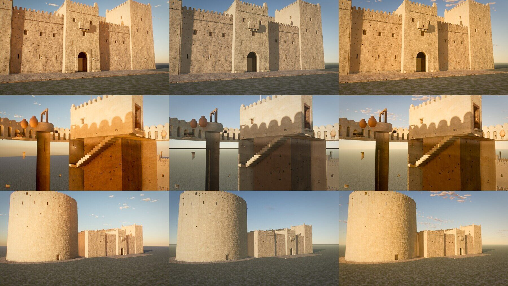
Dusk 19:30, night 21:00, noon:
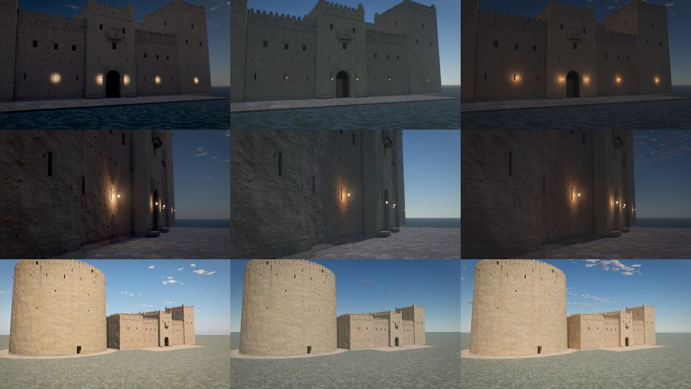

- Golden hour: sunlit plaster within about 0-20 levels of Nizwa per channel (it was 32-40 short in red).
- Dusk and night: the frame's mean matches (19:30: Nizwa 37/40/46, Mirage 37/42/48); every lantern has a pool
  (+16 to +34 levels over the wall, Nizwa +13 to +38); the sky has a dark zenith, a brighter horizon and clouds.
- Still short: the shade under the tower's stair (Nizwa a deep orange: the height field cannot see under the
  overhang), Nizwa's pinker dusk tone, and its larger, uniform lamp discs (Mirage's fall off from the flame).

## What was built

`examples/nizwa-probe/`: a Mirage world (`createWorldRenderer` + `buildWorld` + `createPlay`) with light2,
softShadows, `post.aoLit` and `post.autoExposure` on. Three modules: `ground`, `fort`, `lamps`.

The fort is built by Nizwa's own `src/world/fort.js` and the nine files it imports, loaded from the Nizwa folder
through a vite alias (`@nizwa`). Nothing of Nizwa is copied into this repository, textures included.

| piece | lines | what it does |
|---|---|---|
| `compat/patch.js` | 68 | Nizwa's `patch()` hooks and GLSL names fed to Mirage's `patch()` |
| `compat/ctx.js` | 44 | a Nizwa build context made from a Mirage world; keeps Nizwa's uniforms in step |
| `modules/fort.js` | 29 | Nizwa module result to Mirage module (anchors, ambient volumes) |
| `modules/lamps.js`, `ground.js` | 65 | lanterns and a 4-light pool (Mirage-side code), the ground disc |
| `vite.config.js` | 34 | the alias, one `three` for both code bases, the `patch()` hand-over |

Run it (both dev servers, then the tools):

```bash
cd ~/Documents/阿拉伯魔法原料/oman-golden && npx vite --port 5190
```

```bash
cd examples/nizwa-probe && npm run dev
```

```bash
cd examples/nizwa-probe && node tools/compare.mjs && node tools/bench.mjs
```

Open `http://localhost:5291/?mode=walk` to walk it. `NIZWA_DIR` points the example at another copy of Nizwa.

### Every adaptation

1. **`patch()`**: Nizwa's `src/core/materials.js` is rewritten on load so that its `patch()` calls the bridge. The
   bridge renames hooks (`fragColor` to `albedo`, and so on), wraps `vertexWorld` (Nizwa edits `wPos4`, Mirage
   `mgWorld`), and maps names with `#define` (`vWPos`, `vWNrm`, `uSunDir`, `uSunColor`). 71 materials, 0 failures.
2. **Uniforms**: `uWindDir`, `uWindStrength`, `uLampE`, `uAmbK`, `uBakedSun`, `uShot` stay Nizwa's objects, written
   every frame from Mirage's `uWind`, `uLampGain`, `uSkyLight`. `uBakedSun` is 0 (no bakes for a fixed sun).
3. **Noise and wind GLSL**: Nizwa's `n_*` library and `windOffset()` are added to each material (Mirage's are `mg*`).
4. **Kept from Nizwa unchanged**: its texture layer (`textures.js`, KTX2 sets), `relief.js`, `geom.js` (`Builder`),
   `rng.js` (its own generator, so the fort is the same fort), `layout.js`, doors.
5. **Specular AA**: Mirage's automatic `mgSpecAA` is switched off for bridged materials (Nizwa calls its own).
6. **Ambient volumes**: every box passes with its RGB tint (`factor: 1`, `tint`: Nizwa's tint is the whole value
   inside). Nizwa's ramp runs from `soft` inside the box to `soft` outside, Mirage's from the surface outward, so
   the bridge shrinks each box by `soft` and doubles the ramp (the same curve on every face). Until gap 5 was
   closed the 8 largest went through with the tint's luminance and the ramp unmapped.
7. **Anchors**: `wallLamps` (`pos`, `normal`) become Mirage `lamps` (`pos`, `rotY`).
8. **Ground**: Nizwa's fallback disc, 3,000 m instead of 400 m (Mirage's sky is dark below the horizon).
9. **Look**: `envIntensity: 1` (Nizwa's value; Mirage defaults to 0.5) and `exposure: 0.6` (default 0.4), so sunlit
   plaster is as bright as in Nizwa's stills. Nothing else was tuned.
10. **Doors**: driven by wall-clock time (Mirage's scene clock stands still unless the host animates it).
11. **LOD**: Mirage's `createLod` takes Nizwa's `register` / `update` calls as they are.

## 1. Inventory

Nizwa: 55,859 lines in `src/` (core 6,039; world 31,230; ten maps 16,297; walk, shots, main, embed 2,185).
38 world and map files import from `src/core/` directly; the rest reach it through `ctx`.

| Nizwa `src/core/` | used by world code as | Mirage equivalent | state |
|---|---|---|---|
| `materials.js` `patch`, `std`, `phys`, `glow` | `ctx.mat.*` (71 + 23 + 15 call sites) | `materials.js` `patch`, `createMaterials` | same design, other hook and GLSL names: **bridged** |
| `materials.js` `PROC`, `materials()` | `ctx.M.sarooj`, `masonry`, `palmWood`, ... | `PROC` (generic, smaller) | Mirage has no Omani library; Nizwa's runs through the bridge |
| `materials.js` `fragPhysical` hook | 0 uses in the fort | none | **missing** in Mirage (not needed here) |
| `textures.js` (`ctx.tex.hooks`, `material`, `array`) | 50 + 11 + 3 call sites | `textures.js` (`mgTex*`) | rewritten GLSL API; no decals, no macro tint, no texture arrays, no `NzS.lo`. Nizwa's layer runs as is |
| `relief.js` | 24 imports | `relief.js` | Mirage's is a subset: no `reliefAuto` (automatic rewrite), no recess lips, no `RL_BUMP`. Nizwa's runs as is |
| `glsl.js` (`n_*` noise) | 5 imports | `noise.js` (`mg*`) | other names: included by the bridge |
| `geom.js` `Builder` | 13 call sites | `geom.js` `MeshBatch` | other name and methods; Nizwa's runs as is |
| `rng.js` | 78 call sites | `rng.js` | other generator: a real port changes every seeded shape |
| `light2.js` | 3 imports (`addLampSource`) | `light2.js` | ported (PR #6); works on bridged materials |
| `lod.js` | `ctx.lod.register` | `lod.js` | same API |
| `fog.js` ambient volumes | every module returns them | `setAmbientVolumes` | tinted boxes on a grid, any number: gap 5 closed |
| `fog.js` aerial perspective | global | `fog.js` | Mirage's is thinner at these settings; not tuned |
| `sky.js`, `stars.js`, `sky-time.js` | 2 imports each | same files | near-identical; Mirage's clouds are sparser at the default cover |
| `daynight.js` (572 lines) | `ctx.dayNight` (7) | `daynight.js` (121 lines) | Mirage has no time-of-day grade (split toning, black point, curve), no per-map sky tuning |
| `envlight.js` light keys | via daynight | `envlight.js` | Mirage captures once and cross-fades; no keyed captures |
| `irradiance.js` (509 lines) | via daynight | `gi.js` (`lighting.gi`) | **does differently**: see section 3 |
| `lighting.js` `captureEnvironment` | `ctx.captureEnv` | `world.captureEnv` | different signature (no position argument) |
| `post.js` (1,160 lines) | shots set `post` per shot | `post.js` + `postfx.js` | Mirage lacks godrays, `punch`, `clarity`, AgX mix, lift / gain / gamma per shot |
| `device.js` | `ctx.device` | `device.js` | equivalent |
| `shots.js`, `main.js` film path | 10 shots, per-shot shadow fit, exclusions, fades | `play/timeline.js`, `renderFrame` | no shot format; **not tested** |
| `tools/render.mjs` (117 lines) | film to ffmpeg | `mirage-snap --seq --video` | exists; **not tested** with Nizwa's shots |
| `walk.js` (822 lines) | collision probes, baked `walkgrid.bin` | `@miragekit/play` walk grid | works on the fort (section 3) |
| characters (`life-people.js`, `assets/life/*.bin`) | own instanced skinning | `play/crowd.js`, `rig-character.js` | **not tested**; different data format |
| terrain worker, falaj water, vegetation | own modules | `world/kits/terrain`, `water`, `vegetation` | **not tested**; Nizwa's are far more specific |
| far-lamp splash sprites (`props.js`) | lamps beyond 16 m | none | **missing**: see section 3 |

## 2. The port, measured

- Build: fort in 1.19 s in both. Ready in 8.2 s (Mirage dev server) vs 8.8 s (Nizwa dev server, with props).
- 1.60 M triangles, 67 meshes, 8 texture sets (32 MB on the GPU), all KTX2.
- No shader or page errors. `eslint` and `scripts/check-imports.mjs` pass. The full `npm test` was not run.
- Walk: the walk grid bakes from Nizwa's geometry. A walker goes from the forecourt through the gate passage
  (ceiling 4.7 m in the grid) into the court; doors swing open for it. Stairs and the tower top were not walked.

## 3. Comparison

Same camera, same lens, 2026-10-25 at Nizwa, 1280 x 720, 8 sub-frames. Left Nizwa (`modules=fort,props`), right
Mirage.

| view | image |
|---|---|
| approach, 17:00 | 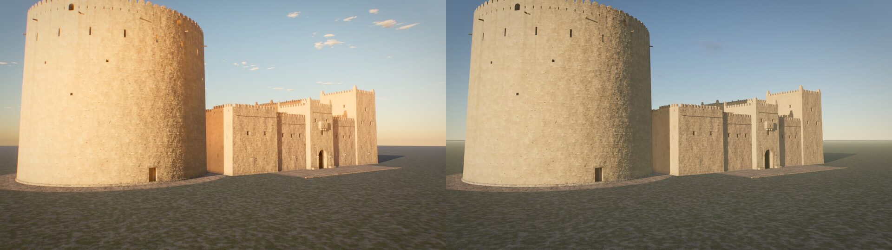 |
| gate, 17:00 | 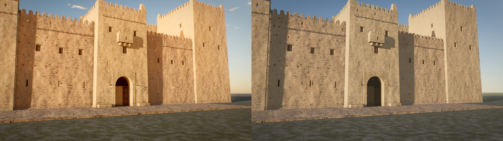 |
| wall (close), 17:00 | 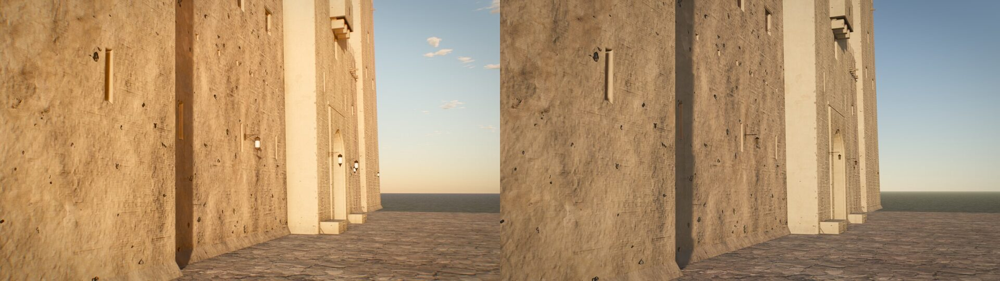 |
| inside the tower, 17:00 | 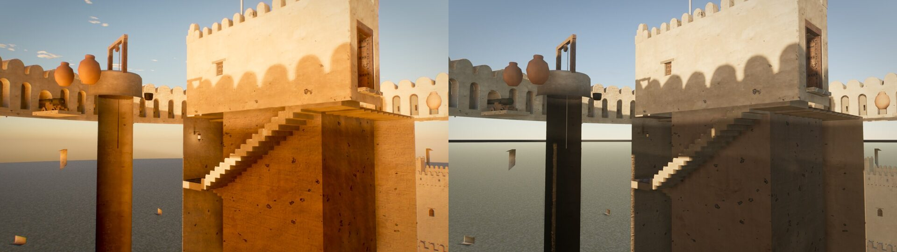 |
| approach, 12:00 | 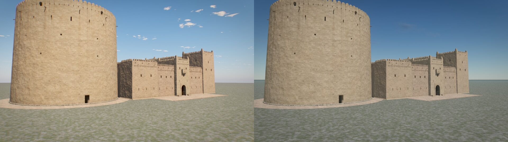 |
| gate, 19:30 | 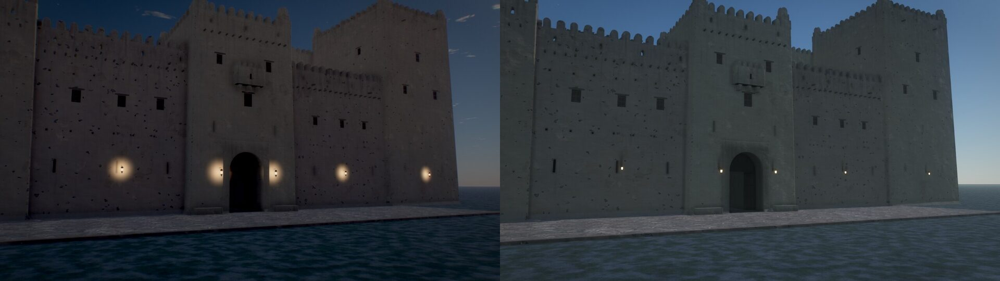 |
| wall, 21:00 | 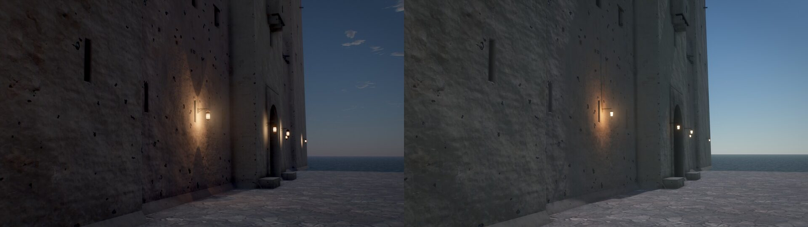 |
| walking, forecourt 17:00 | 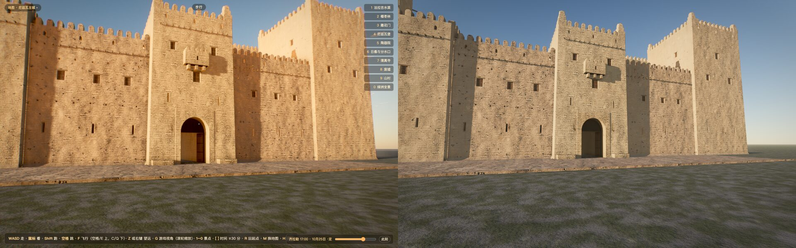 |
| walking, wall 21:00 | 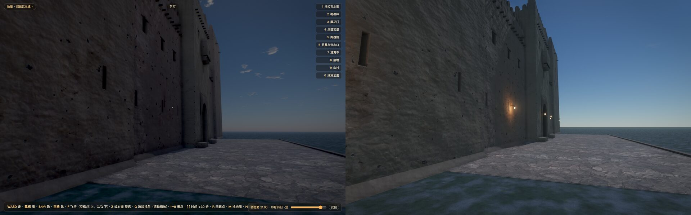 |
| Mirage, look pack off / on, 17:00 | 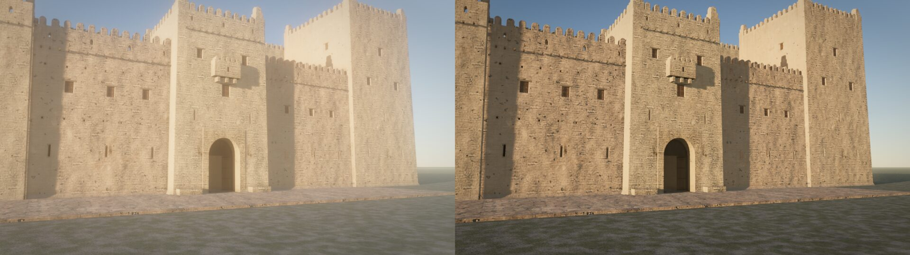 |
| Mirage, look pack off / on, 21:00 | 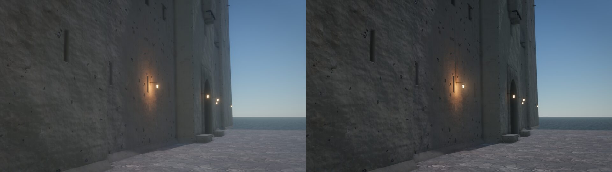 |
| a fort door opening for the walker (Mirage) | 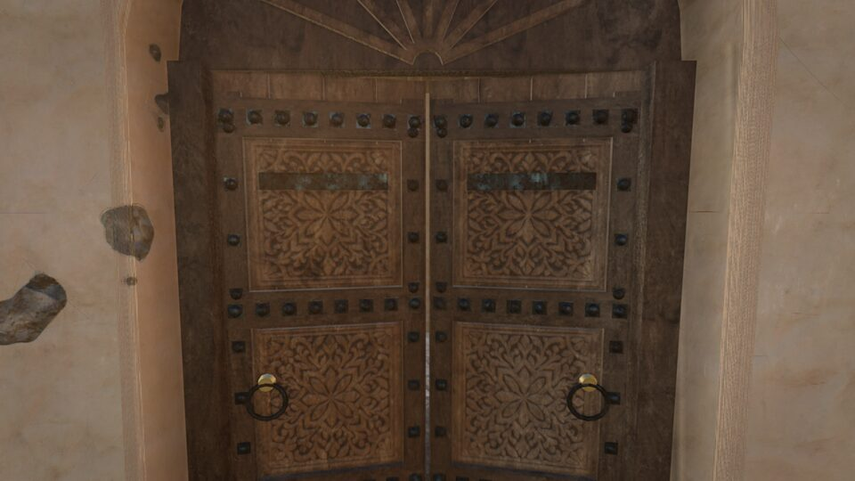 |

### What looks worse in Mirage, and why

1. **Golden hour is not golden.** Nizwa's sunlit plaster is deep orange, Mirage's pale sand. Nizwa applies a
   time-of-day grade (warm split toning, `punch`, an AgX / ACES mix); Mirage has exposure, saturation and a small
   warmth term.
2. **Shade has no bounce.** Inside the tower, Nizwa's shaded walls glow orange from the sunlit ones (its
   irradiance volume); Mirage's are grey. Mirage's own probe GI (`?gi=1`) was tried once: it took 51 s to prepare
   and made the shade darker, not warmer. Whether that is the feature or the bridged materials was not investigated.
3. **Distant lamps do not light the wall.** At 19:30 Nizwa shows a pool round every lantern; Mirage shows five
   dots. Nizwa draws a sprite pool for lamps beyond the four real lights; Mirage has nothing for them.
4. **Dusk and night sky.** Mirage's sky at 19:30 and 21:00 is a flat bright blue with a hard horizon; Nizwa's is
   dark with an afterglow and haze. Mirage's night exposure lifts the whole frame.
5. **Sky dressing.** Fewer clouds at the default cover; no haze at the horizon.

### What looks better in Mirage

1. **Soft sun shadows.** The merlons' shadows on the wall sharpen toward the contact and soften with distance;
   Nizwa's are uniformly sharp.
2. **Lamp shadows up close** are equal (both have light2); the bracket's shadow on the wall is there in both.
3. **Noon** is a draw.

Close-range relief, carved doors, stains and texture detail are identical: they are Nizwa's own materials.

### Frame cost

Walk view, 1440 x 900, Chrome without vsync, camera turning, mean frame interval in ms (best of 3 runs of 240
frames; run-to-run noise about 5 %). Nizwa is `modules=fort` (no lamps); Mirage also draws 36 lanterns and 4 pooled
lights.

| spot | 17:00 Nizwa | 17:00 Mirage | 21:00 Nizwa | 21:00 Mirage |
|---|---|---|---|---|
| forecourt | 9.00 | 9.06 | 8.50 | 8.12 |
| wall | 6.53 | 7.59 | 6.15 | 6.54 |
| tower foot | 10.76 | 11.08 | 10.58 | 10.45 |
| far | 7.79 | 6.52 | 7.37 | 5.41 |

With Nizwa's `?nolight2` and Mirage's four look-pack features off, Mirage is 1 to 28 % faster (for example
forecourt 17:00: 8.76 vs 7.42). So the look pack costs Mirage about 1 to 1.8 ms at most spots and brings it level
with Nizwa. Raw rows: `media/bench-lookpack-on.json`, `media/bench-lookpack-off.json`.

### Load size

Production builds, what the page fetches for the fort alone:

| | JS | JS gzip | textures | wasm | total |
|---|---|---|---|---|---|
| Nizwa (`modules=fort`) | 1.25 MB, 26 files | 0.37 MB | 10.83 MB | 0.5 MB | 12.59 MB |
| Mirage probe | 1.32 MB, 1 file | 0.39 MB | 10.83 MB | 0.5 MB | 12.66 MB |

The same: textures dominate and are Nizwa's. The probe's build copies every texture set into `dist` (45 MB) because
Nizwa's texture layer globs the whole folder; the page fetches only the 8 sets it uses.

## 4. Gap list (what Mirage needs before Nizwa could move)

| # | gap | needed for | size |
|---|---|---|---|
| 1 | time-of-day grade (split toning, black point, curve, tone-map mix) | the golden-hour look, every still and the film | medium |
| 2 | bounce light that matches Nizwa's irradiance volume, or a fix for `lighting.gi` on these materials | shade, interiors, lanes | large |
| 3 | far-lamp pools (sprites or a light proxy) | every dusk and night view | small |
| 4 | dusk and night sky and exposure (afterglow, horizon haze, darker night) | 19:00 to 06:00 | medium |
| 5 | ambient volumes: more than 8, with a tint (**done**: a grid in a data texture, 1,000 boxes cost what 8 do) | the town's 956 rooms, the mosque | medium |
| 6 | texture layer: decals, macro tint, texture arrays | terrain, town walls | medium (or keep Nizwa's layer) |
| 7 | relief: `reliefAuto`, recess lips | 24 world files | small (or keep Nizwa's) |
| 8 | per-shot post (godrays, DOF by f-stop, lift / gain / gamma) and a shot format | the film | medium |
| 9 | `fragPhysical` hook | not counted; 0 uses in the fort | small |
| 10 | doors in the walk grid (re-bake a region when a leaf swings) | interiors | small |

## 5. Effort to port all of Nizwa

Estimates, from this one module. The unit is one agent working session of the size that built this probe.

| part | lines | route | sessions | confidence |
|---|---|---|---|---|
| fort | 3,219 | done through the bridge | 0 | measured |
| mosque, town, props, falaj structures | about 17,000 | same bridge; ambient volumes (gap 5) first | 3 to 5 | medium: same material and geometry code |
| terrain, vegetation, falaj water | about 9,000 | bridge plus texture arrays, worker, wind, custom depth materials | 3 to 5 | low: not tried |
| life (people, animals) | about 2,500 + 5 MB data | own skinning; keep as is or move to `play/crowd` | 2 to 4 | low: not tried |
| ten maps | 16,297 | bridge, plus per-map sky and fixed hours | 4 to 6 | low: not tried |
| walk, embed, the game's hand-over | 2,185 | replace with `@miragekit/play`; the game embeds Nizwa through `embed.js` | 3 to 5 | low |
| film (10 shots, `render.mjs`) | 342 | shot format and per-shot post on Mirage (gap 8) | 2 to 3 | low |
| Mirage gaps 1 to 5 | new engine code | must stay opt-in and keep stills bit-identical | 5 to 8 | medium |

Total: roughly **22 to 36 sessions** to reach the picture Nizwa has now, before any gain. A "real" port that also
rewrites the materials in Mirage's own idiom (`mgTex*`, `MeshBatch`, Mirage's `rng`) would add the 71-material
rewrite per module and change every seeded shape; this probe shows it is not needed.

## 6. Risks

- **The look regresses first.** Until gaps 1 to 4 are closed, every ported view is worse at the hours that matter.
- **Two engines in one page.** The bridge depends on Nizwa's `patch()` signature and on a `#define` name map; a
  change on either side breaks it silently (a shader that compiles but reads the wrong uniform).
- **The game.** `kulluhu-sirr-game` embeds Nizwa through `embed.js` with shared globals; that hand-over has no
  Mirage counterpart and 631 unit tests sit on it.
- **Mirage's rules.** Each new feature must be opt-in with bit-identical stills when off; the grade and the sky
  work touch the paths every example renders through.
- **Unverified here**: the film path, characters, terrain, phones, determinism of the bridged stills, anything
  outside the fort. The frame-cost parity is for 1.6 M triangles; the town is 25.7 M.

## 7. Recommendation

1. **Keep Nizwa on its own engine.** It is ahead where it matters and loses nothing in speed or size.
2. **Back-port two features into Nizwa**: soft sun shadows (`softshadow.js`; the visible win in these stills) and
   auto exposure. Both are single files with a small surface. AO on ambient only and dynamic resolution are
   optional; wetness needs each material to opt in and is the most work.
3. **Close gaps 1, 3 and 4 in Mirage** (grade, far-lamp pools, dusk sky), then investigate gap 2 (bounce). These
   make Mirage's own examples better whether or not Nizwa ever moves.
4. **Re-run this probe** (`node tools/compare.mjs`) after each. When the golden-hour and dusk pairs match, port
   module by module through the bridge, starting with the mosque.

Follow-ups noticed and not done: the `lighting.gi` result on bridged materials; Mirage's sky is black below the
horizon when no ground reaches it; `play`'s `renderer.info` reads 1 call after a frame (the last pass), so tools
cannot report draw calls.
